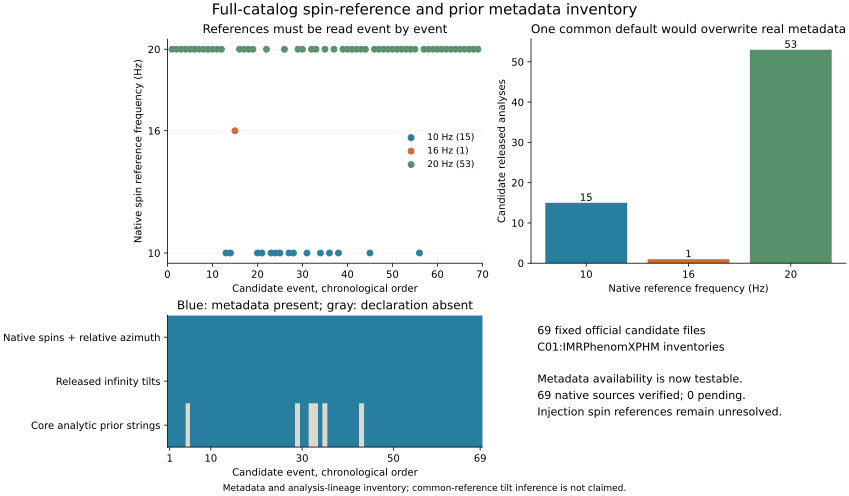
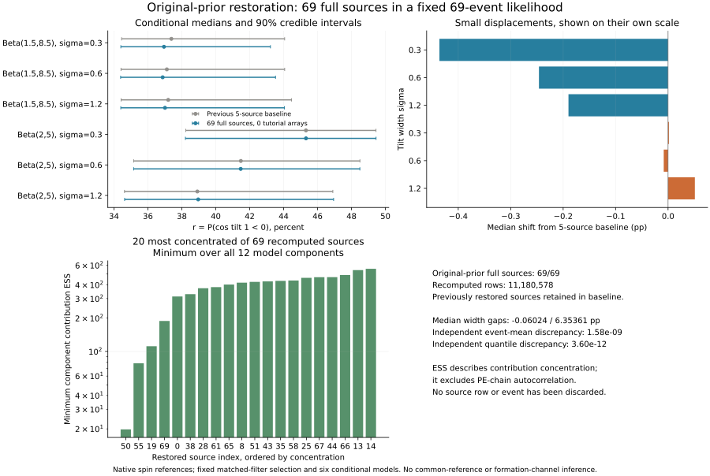
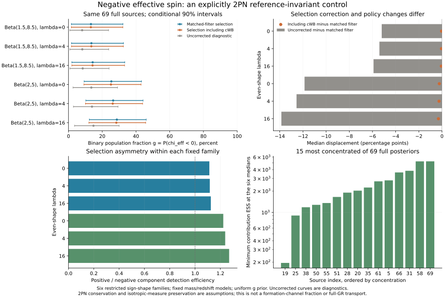
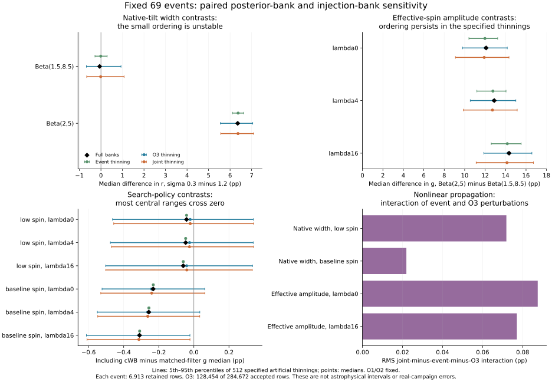
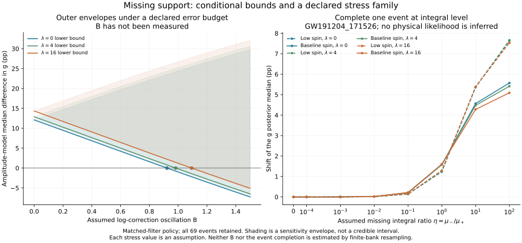
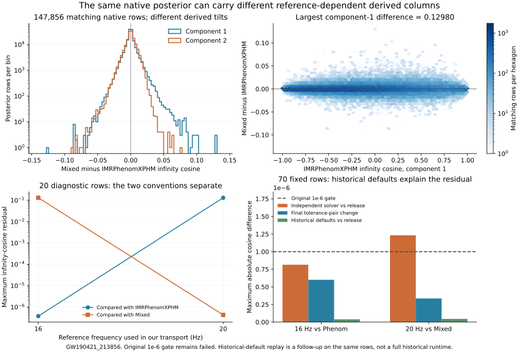

# 全目录来源扩展与参考频率派生字段核查

2026-10-25。固定69事件的原始先验后验现已全部恢复，合计11180578行；全目录原生参考的重加权与独立核验完成。本文保留早期两事件和20事件快照，再记录全69来源结果、有效自旋控制、成对有限银行与未见贡献的条件边界。共同物理参考下的全倾角群体推断仍未完成。

## 候选元数据清单

使用此前固定的[GWTC-2.1发布6513631](https://zenodo.org/records/6513631)与[GWTC-3发布5546663](https://zenodo.org/records/5546663)。69个原始先验文件总大小23554981402字节，现已全部核对官方MD5和本地SHA256。文件名和目录GPS时间用于排除同名歧义：GW190521对应030229文件，不能误取另一事件074359。实际来源还须逐行连接：全部69事件现已确定单波形分析来源；部分文件的包含标签仍不唯一，不能把它们写成69个唯一容器标签。最新机器结果见[native-catalog-results.json](native-catalog-results.json)。

|候选`C01:IMRPhenomXPHM`分析的元数据|结果|
|---|---:|
|原生参考频率20 Hz|53|
|原生参考频率10 Hz|15|
|原生参考频率16 Hz|1|
|相对方位角与所需原生自旋字段齐全|69/69|
|公开两个无穷远倾角字段存在|69/69|
|核心解析先验字符串齐全|63/69|

六个缺少这组解析先验声明的事件是GW170608、GW190707_093326、GW190720_000836、GW190725_174728、GW190728_064510、GW190924_021846。后续从各自发布的LALInference配置和固定历史源码恢复默认先验族，见下节；它们仍不计入“解析先验字符串齐全”的63份中。



HTTP Range读取检查206状态、精确Content-Range和文件总长度，保存块散列。对三个完整校验的本地文件，访问到的全部字节及解析元数据均一致。远程清点没有读取每个完整文件，故不声称核验了69份完整MD5。四进程读取曾遇到限流，随后改为两进程、每进程请求间隔至少3秒、1 MB块，并对唯一剩余TLS失败作缓存重试；最终69项全部完成。过程见[retrieval-history.json](retrieval-history.json)，旧失败记录保留。

## 两个新增完整后验及条件传播

按[计算前记录的探索性设计](design.md)，新增GW150914（index 0，早期来源检查）和GW190421_213856（index 14，16 Hz参考恢复检查）。两份HDF合计621802896字节，官方MD5和本地SHA256均核对。

- GW150914的6913条教学行全部精确连接到Phenom标签；完整原始先验后验有199766行，标签连接无歧义。
- GW190421的6913条教学行同时出现在Phenom和Mixed标签中。不能声称标签唯一；对两个完整标签作147856行双射后，27个被检查的原生输入列完全相同，包括质量、六自旋分量、相对方位角、外禀角和log likelihood。其原生后验相同，部分派生字段不同。恢复原生输入时，采用具有明确波形、16 Hz和先验声明的Phenom标签，同时保留差异记录。

完整原生后验恢复由5事件扩展到7事件，共1250648行；不表示全部69事件均已恢复。

固定此前五事件完整后验基线、69事件集合、六模型、共同r先验和历史O1/O2+完整O3匹配滤波选择函数，只替换新增事件积分，保留原生坐标。

|替换情形|六设定最大绝对中位数位移(pp)|低自旋宽度差(pp)|基线幅度宽度差(pp)|
|---|---:|---:|---:|
|此前五事件基线|0|0.185794|6.403081|
|再加入GW150914|0.004080|0.181027|6.396517|
|再加入GW190421|0.012038|0.200140|6.401722|
|联合加入两个事件|0.010664|0.195375|6.395156|

宽度差是sigma=0.3与1.2设定的r后验中位数之差；r是模型定义的负倾角余弦概率，不是形成渠道比例。见[catalog-comparison.json](catalog-comparison.json)。

[独立核验](comparison-validation.json)重查教学行和全部phi12源列，用显式平直LambdaCDM距离积分及独立密度公式重算事件矩，再计算完整69事件乘积。新事件均值最大相对差1.14e-9，分位数最大差2.54e-13；网格加密差1.58e-7以内（r单位）。这些检查未恢复先验支持外的似然。

## 六份配置先验与20事件快照

六份缺少解析字符串的文件均保存了LALInference引擎配置。逐项恢复质量、探测器系啁啾质量、距离和自旋幅度范围，并检查未启用替代距离/自旋先验的已知选项。结合[LALSuite 7.0固定提交](https://git.ligo.org/lscsoft/lalsuite/-/tree/af4bc21a9f9246ef5403052ec3b66ed2b52d90ed)中的先验和初始化分支，支持其默认先验族为：探测器系分量质量平坦、距离密度正比于D_L²、自旋幅度均匀、倾角各向同性。我们的源坐标中，忽略每事件固定归一化常数后，密度为

\[
\pi(m_1,q,z,a_1,a_2,c_1,c_2)\propto
D_L(z)^2\frac{dD_L}{dz}\,m_1(1+z)^2/4.
\]

所有六份配置的自旋上限为0.99、q下限为0.05，距离上限分别为1000、2000、3000、3000、2000、2000 Mpc。保存的波形配置名是`IMRPhenomXPHMpseudoFourPN`，不能因标准化元数据省去了后缀，就声称其全部波形设置与其他事件相同。[配置恢复](configuration-prior-recovery.json)明确区分显式设置、源码默认值和未重建的历史运行环境。

20事件快照中，六份配置事件仅GW170608已恢复完整后验：285112行均满足记录范围；历史采样坐标密度乘数值五维Jacobian，与源坐标直接公式的最大相对差1.24e-8。其余五事件的完整行检查等待文件恢复。配置和默认族恢复不约束先验支持外的似然，也不证明没有未记录的运行覆盖选项。

固定69事件、六模型、共同r先验及完整O3匹配滤波选择项，将完整原始先验来源扩展到20事件，其余49事件保留原教学表示。新增重算15事件，共2664639行；加上此前五事件903026行，已使用完整原始后验合计3567665行。

|比较量|此前5事件完整来源|20事件完整来源快照|
|---|---:|---:|
|低自旋组宽度差(pp)|0.185794|0.148876|
|基线自旋幅度组宽度差(pp)|6.403081|6.415842|
|六设定最大绝对中位数位移(pp)|0|0.121909|

快照见[20事件结果](native-snapshots/20-native-catalog-results.json)及[对应独立校验](native-snapshots/20-native-catalog-validation.json)。独立程序重新计算15事件的坐标恒等式、距离积分、先验密度和目标密度，再计算完整69事件乘积：事件均值最大相对差1.58e-9，分位数差1.04e-12。1001到2001网格差1.21e-7（r单位）。这说明实现相符，不等于真实注入活动或PE链的采样误差已校准。



该图由最新结果与其匹配散列的独立校验生成，可随剩余来源恢复而更新。图中ESS是12个模型/分量积分中最小的权重贡献ESS，未计入PE链自相关。它与模型中位数处的混合积分ESS不同，不应直接套用另一诊断的阈值。没有据此删除任何事件或源行。

下载器只处理固定清单，最多两个并行流，逐文件核对官方MD5和本地SHA256，复用旧阶段已核验原文件。提取器将全部教学行精确连接到源行；多标签匹配时，须另外证明完整原生输入双射等价。派生字段等价不能从原生输入等价自动推出。增量积分缓存避免重复计算已恢复事件，但不把未恢复来源标成完成。

`process_available_catalog.py`按依赖顺序执行提取、配置行检查、传播、独立校验和绘图；任一步失败即停止。可用`--follow-downloads --maximum-minutes 90`跟进本次固定69文件恢复，每新增至少4份已核验文件再处理，并保存逐批结果快照。该模式有时限，下载器失败或来源未解也会停止；它不创建定时任务、不下载额外数据、不执行Git发布。其本机锁和运行状态不进入发布。

扩展到35来源时，独立校验曾因GW190719_215514的142条源后验行超过目标模型红移上限2.3而停止，最大源红移为2.41020。原推断程序已正确对目标支持外赋零；错误在独立校验器假定所有PE行都落在目标范围内。修正后，PE先验的独立距离积分覆盖全部源行，目标密度另施显式范围掩码；保留全部153538行作为事件均值分母，没有删除142行或放宽误差阈值。35来源复核的分位数差2.18e-12，见[native-validation-history.json](native-validation-history.json)。图表和最新结果继续随后续已验证批次更新，20事件表格为固定历史快照。

后续六份配置事件的完整行核查均已完成，共1020789行，记录范围违规数均为零；32个/事件检查点的数值五维Jacobian最大相对差3.83e-6，小于原定1e-5门槛。这里的配置恢复和检查仍不约束支持外的似然。

GW191103_012549（index48）出现了另一种标签歧义：全部教学行同时存在于nocosmo的Phenom与Mixed标签，但两份完整后验不等价。不能套用index14的完整双射规则。利用阶段三已核验的cosmo发布，教学6913行唯一匹配其Phenom标签；该标签的全部9914行又单射连接到原始先验Phenom的167837行，27个原生输入列逐项完全相同，配置与原始解析先验声明也相同。[三方连接证据](cosmo-lineage-resolution.json)因此确定单波形分析来源，同时保留nocosmo包含标签不唯一、Mixed完整后验不等价的事实。`resolve_cosmo_lineage.py`须在提取index48前运行，不据同名标签或少量重合直接判定来源。

最后的GW200316_215756（index72）也须区分分析来源与包含标签。原始先验Mixed的268806行可精确拆为完整Phenom的134403行与SEOB的134403行子集；两部分输入点不重合，分别在27个原生列上完全一致。教学6913行全部且唯一来自Phenom波形部分。见[完整混合分解](mixture-component-resolution.json)。因此本项目采用完整Phenom进行固定单波形控制，保留容器标签歧义，不将Mixed与Phenom完整后验视作等价，也不声称复现LVK波形边缘化分析。

## 全69来源的原生参考结果

固定此前的事件集合、六模型、共同r先验和匹配滤波选择项。全部69事件改用各自完整原始先验Phenom后验，共11180578行；不再保留教学子数组充当任一事件积分。63事件由解析先验声明核验，6事件由发布配置和历史默认族核验。

这里是每事件选择一份Phenom族分析；不表示69事件具有完全相同的波形设置。六个LALInference配置的`pseudoFourPN`后缀仍保留在来源记录中。

|比较量|此前5完整来源基线|全部69完整来源|
|---|---:|---:|
|低自旋组宽度差(pp)|+0.185794|−0.060238|
|基线幅度组宽度差(pp)|6.403081|6.353613|
|最大绝对中位数位移(pp)|0|0.435880|

低自旋小差异变号，足以说明早期部分来源控制未证明该差异的符号稳健；这不是形成渠道反转的证据。另一幅度族的较大条件差异仍在。原生参考仍有10/16/20 Hz区别，故这里的r仍须按条件诊断解释。原5事件基线属于保存的对照，未覆盖或重算其历史结果。

[完整69快照](native-snapshots/69-native-catalog-results.json)及[独立核验](native-snapshots/69-native-catalog-validation.json)检查全部源后验的密度、坐标及完整69事件乘积，分位数最大差3.60e-12。全部字段/配置来源、标签例外及失败修正分别保存。原始冻结三文件的散列不变。数值实现相符不等于PE链相关性、先验支持外似然或真实注入活动误差已解决。

## 有效自旋参考不变量的补充控制

在真实目录拟合之前记录[设计](../population-invariant/design.json)。新量是双星总体的g=P(chi_eff<0)，与主黑洞负倾角比例r不同。在明确的2PN有效自旋守恒及各向同性角度测度保持的近似下，选择依赖不变量的归一化角度密度，避免把不同频率的倾角直接当成同一量。它没有恢复未知注入执行配置，也不是精确全GR运输。

令x=(a1*c1+q*a2*c2)/(1+q)，u=a1/(1+q)，v=q*a2/(1+q)。六个固定控制为两种幅度Beta族与lambda={0,4,16}的组合，其角度密度为

\[
p(c_1,c_2\mid q,a_1,a_2,g,\lambda)=
\frac{1+\lambda x^2}{4[1+\lambda(u^2+v^2)/3]}
\big[2g\,\mathbf1_{x<0}+2(1-g)\,\mathbf1_{x>0}\big].
\]

偶因子使正、负半空间各占对称基底的一半，因此g恰为负有效自旋比例，幅度与质量分布保持原设定。g先验均为[0,1]均匀。该受限族在零处可有密度跳变；三个偶形状和两种幅度不代表所有合理模型。不是新形成模型，也不分配模型概率权重。

[相对方位角先验核查](../population-invariant/azimuth-prior-audit.json)确认63份解析声明为[0,2pi]均匀，另6份发布配置没有读到方位角/固定参数覆盖选项，历史默认分支注册相同均匀范围。这核查的是事件层先验前提，不能证明PN动力学保持测度或重建全部历史运行。

|幅度族|lambda=0|lambda=4|lambda=16|
|---|---:|---:|---:|
|Beta(1.5,8.5)，g中位数与90%区间(%)|13.29 [1.69,32.27]|13.57 [1.77,32.57]|14.32 [2.00,33.33]|
|Beta(2,5)，g中位数与90%区间(%)|25.39 [9.26,43.27]|26.47 [10.24,44.20]|28.66 [12.33,46.06]|

匹配滤波选择下，两幅度族同lambda的中位数差为12.10–14.34 pp；各幅度族lambda16相对0的差为1.03/3.27 pp。可信区间明显重合，不能将中位数差当成两总体统计不相容或形成比例测定。去掉选择修正的诊断曲线比匹配滤波结果低5.20–13.86 pp；加入cWB并集使中位数再变动−0.042至−0.309 pp。这里不同比较轴的量级不同，不据此声称真实选择MC误差已小于某个数。



[独立核验](../population-invariant/control-validation.json)从Cartesian自旋重算所有69事件、完整O3和早期注入，事件均值最大相对差2.17e-9，完整乘积分位数差1.38e-11以内；网格从1001/2001继续加到4001，最终分位数变化7.31e-7以内。全部11180578行在公开无穷远倾角与原生值之间的chi_eff最大差5.55e-16，没有符号变化；角度密度比差7.11e-15以内。这是发布字段的不变量检查，不是对真实PN测度误差的独立证明。

120个分域角度积分验证归一化和负值概率，最大差5.11e-15。另对四个已知效率/符号误差的离散选择实验枚举全部70种计数，用独立二项分布、积分和求根校验程序：先验平均90%区间覆盖率偏差小于7.6e-7。该校准不包含GW应变噪声、真实PE链或有限注入银行；事件贡献ESS最小约195也不能替代这些误差评估。

当前结果支持继续检验“共同量在参考约定控制后仍有多大的模型/选择依赖”，不支持从这六个检查模型直接给出形成渠道占比。原倾角问题、支持外似然及全活动MC校准仍是必要后续工作。

## 全69事件的成对有限银行诊断

以下结果使用全69原始先验后验，而非旧五事件替换基线。预先记录的
[O3设计](../population-invariant/paired-o3-design.json)与
[事件/联合设计](../population-invariant/paired-pe-design.json)分别固定512次抽稀。
每事件从各自完整后验中无放回等概率抽取6913行；O3从284672条接受行中抽取128454行。
同一行索引在两指标、六模型和两搜索规则间共享；事件流与O3流独立，O1/O2保持固定。
观察事件数始终为69。6913只是数值设计，不是事件数，也不复现历史cosmo拒绝抽样。
O3沿用旧随机流以便成对重分析，不构成新增独立重复实验。

匹配滤波规则下的中位数**差**（单位pp）如下；后三列是指定人工抽稀的5/50/95分位数：

| 对比 | 全银行 | 仅事件抽稀 | 仅O3抽稀 | 联合抽稀 |
|---|---:|---|---|---|
| 原生倾角宽度差，Beta(1.5,8.5) | −0.06024 | −0.27762 / −0.00871 / 0.28864 | −0.67635 / −0.07157 / 0.93162 | −0.66129 / −0.01255 / 1.07475 |
| 原生倾角宽度差，Beta(2,5) | 6.35361 | 6.11234 / 6.37239 / 6.63749 | 5.54825 / 6.33266 / 7.05197 | 5.56441 / 6.36748 / 7.09593 |
| g幅度模型差，lambda0 | 12.09798 | 10.41179 / 11.97928 / 13.22472 | 9.79154 / 12.01488 / 14.16356 | 9.09694 / 11.90706 / 14.33273 |
| g幅度模型差，lambda4 | 12.89221 | 11.19287 / 12.75968 / 14.04066 | 10.54595 / 12.81072 / 15.00130 | 9.87062 / 12.71670 / 15.13535 |
| g幅度模型差，lambda16 | 14.34202 | 12.59771 / 14.16751 / 15.52222 | 11.87412 / 14.24193 / 16.57049 | 11.12222 / 14.13757 / 16.72407 |

宽度差定义为sigma0.3减1.2；g幅度差定义为Beta(2,5)减Beta(1.5,8.5)。
原生低自旋差在55.47%的O3抽稀、50.98%的联合抽稀中非正；这些比例不是p值。
其事件、选择、联合标准差依次为0.17642、0.49261、0.56206 pp，显式
joint−event−selection+full交互的RMS为0.07185 pp。
g的三项幅度差在全部512次联合抽稀中为正，但这不证明超出当前固定银行的普遍稳健性，
也不消除原总体后验可信区间的重叠。



[O3独立校验](../population-invariant/paired-o3-validation.json)复核512组索引指纹与完整后验乘积；
[事件/联合独立校验](../population-invariant/paired-pe-validation.json)复核全部69源的24维均值协方差、
每源512组抽样指纹及全部512组event-only和joint完整乘积。源均值最大相对差2.17e−9，
协方差最大相对差3.16e−9；event-only/joint分位数差分别不超过1.53e−14/1.40e−14。
源均值的抽样求和检查包含各对比的极值重复，而不是声称全部512组均逐行重算权重。

保留一次导数验证失败：原1e−6差分步长相对误差1.04060e−4，略超不变的1e−4门槛。
[诊断](../population-invariant/pe-derivative-diagnosis.json)显示弱导数的中位数差约6e−12，存在消减误差。
改用1e−5步长在原门槛下通过，最大误差4.88e−6；另以两种复数步长独立核查。
生产后验、抽样和解析Jacobian没有因此修改；不把原失败重新标为通过。

这些是条件于公开有限银行的人工敏感性实验，不是天体物理可信区间、PE链相关性校准、
真实活动MC误差或实际历史抽样覆盖率。GW191204_171526的206292行银行在六个g模型上
均缺少负分量贡献；重抽银行在这些方向上的协方差为零，不能解释为真实负分量似然为零。

## 未见贡献：边界、压力测试及后续精度要求

[设计](../population-invariant/support-design.json)在上述银行零贡献被发现后、以下输出前记录，
明确属于诊断后的跟进，不是前瞻发现检验。以下给出实际可计算的条件边界，
但没有从已有样本中恢复真实缺失似然。

设基线归一化总体后验为p(g)，未知修正为正函数h(g)，且
`ess sup(log h) − ess inf(log h) <= B`。将h乘一个常数不影响后验，故可令`1 <= h <= exp(B)`。
对任意累计概率F，对阈值两侧分别取端点权重，可得尖锐界

```text
F / (F + exp(B)*(1-F)) <= F_corrected <= exp(B)*F / (1-F + exp(B)*F)
Q(expit(logit(q)-B)) <= Q_corrected(q) <= Q(expit(logit(q)+B))
TV(p_corrected,p) <= tanh(B/4)
```

尖锐性针对所有满足该振幅界的正函数，并不证明这些极端权重能由同一个物理波形似然或
共同检出函数产生。假如每个事件遗漏积分的相对上界均匀受epsilon_i约束、
遗漏选择贡献相对上界受eta_selection约束，而且银行内积分视为精确，
则可取`B = sum(log(1+epsilon_i)) + 69*log(1+eta_selection)`。
这些界必须在所有比较的g上成立；已有积分为零但补入为正时，有限相对界失效。
银行抽稀、ESS或缺失区域的先验质量都不能自动提供这样的真实预算。

[结果](../population-invariant/support-results.json)中，匹配滤波三项幅度差的外包络下界
分别在B=0.92251、0.98246、1.09371触及零；含cWB时为0.90978、0.96835、1.07682。
只考虑选择遗漏、并假设所有g上的相对界成立时，前组三阈值对应1.346%、1.434%、1.598%的上界。
若只考虑69事件、每事件等额均匀相对遗漏界，也有相同数值；两项同时存在时必须分摊同一B预算。
这是“充分排序保证何时失效”，不是观测到了物理翻转，也不是测得了缺失贡献大小。

另一项独立压力测试只将GW191204_171526的六个事件分量积分从
`(0, mu_positive)`改为`(eta*mu_positive, mu_positive)`，保留其余68事件与完整选择函数。
eta是积分比，既不是缺失后验概率，也未被数据估计；所有六模型共享eta只是声明的压力族，
不声称由同一物理似然实现。eta=0.01时匹配滤波g中位数位移约0.014–0.022 pp；
eta=1时为1.23–1.60 pp；eta趋于无穷的归一化极限为5.20–8.02 pp。
在同一eta的这组压力族中，三项幅度差仍为正；这与更宽泛B外包络可能失去保证并不冲突。



[独立校验](../population-invariant/support-validation.json)以普通乘积重算九种补入、两规则、六模型，
再用Simpson累计积分和直接求根检查分位数，最大差2.16e−7（门槛2e−6）。
从“两CDF之和为1的共同位置”独立求排序阈值，B差不超过1.31e−6；
分域积分核查CDF界，最大差2.99e−7。另核验两点分布达到TV界、独立距离/体积积分及Beta生存积分。
这些验证只检查数学和实现，不验证真实缺失预算。

固定红移模型在1.9<z<=2.3上有33.4075%的总体质量。O3只支持z<=1.9、
两个自旋幅度<=0.998；已知遗漏域并集的质量几乎完全由红移尾部主导。
这里分别记录连续宇宙学积分与代码实际线性插值/归一化测度；遗漏选择上界使用后者，
并保留极小的归一化偏差，避免将连续近似的质量直接混入代码效率。
以该域内检出概率<=1给出的O3时间加权遗漏选择贡献上界为0.15214，
约为基线中位数处已表示选择效率的137–143倍，无法给出有用的小误差保证。
这是该特定遗漏域的粗上界，不是总选择偏差的上界，也不是实际漏检贡献估计。
Beta(2,5)在任一自旋>0.99的先验质量仅1.19e−9，同样不能单凭此约束事件似然积分：
若无区域内似然上界，微小先验体积仍可能携带重要贡献。

[下一步资源规划](../population-invariant/tail-validation-plan.json)将**假设的0.5%选择遗漏预算**
换算为可验证的目标：六模型的两个符号分量分别从已知遗漏域的目标分布独立直接抽样，
在恢复的O3检出协议下检验。零检出情形，以12项Bonferroni同时95%保证的精确二项上界，
计划合计需要2127038条直接注入；出现检出后须重算上界。
这不是已执行的活动，重要性加权样本也不自动服从该二项设计。
历史O3参考、时间/噪声与搜索协议必须先核验，不能用新任意协议冒充历史检出律；
事件遗漏、银行内MC和波形误差仍需单独预算。

本次负结论是：已有银行能支持受控条件比较，却不能独自认证完整支持下的物理稳健性。
有限银行误差与未见贡献是两件可定量区分的事；当前尚未得到真实形成渠道比例。
[Talbot & Golomb](https://arxiv.org/html/2304.06138v2)已说明重采样不能越出既有样本；
[Essick等](https://arxiv.org/html/2508.10638v2)的附录C明确要求目标支持被注入分布覆盖。
本工作不把这些原则、一般边界或抽稀方法视为新方法发现。

## 同一原生后验的两组无穷远倾角

GW190421两个标签的主/次黑洞无穷远倾角余弦最大差分别为0.129804和0.088321，中位绝对差为0.002898和0.003780。chi_eff守恒至约3.4e-16，不能仅凭它一致就认定整个自旋转换一致。

1. Phenom明确声明16 Hz；Mixed缺少f_ref，两标签也都未保存reference_frequency后验列。
2. HDF记录PESummary版本`0.13.3+4.gf4e1c37`。对应[历史提交源码](https://github.com/pesummary/pesummary/blob/f4e1c37161f66419724706eaa5d81b0c9c5097a6/pesummary/gw/conversions/__init__.py)第685行附近在f_ref缺失时补20 Hz，第1219行附近将它传给无穷远演化。
3. 沿用已核验的2PN非自旋角动量初始化及独立DOP853积分，在16条均匀间隔行加4条最大差异行上，16 Hz与Phenom字段相符至3.72e-7，20 Hz与Mixed相符至4.26e-7。交叉采用另一频率则保留约0.13差异。
4. 另选64条随机留出行及6条按原生输入极值选择的压力行，排除20条诊断行。16/20 Hz的最大目标余弦残差分别为8.14e-7和1.23e-6。

**原定1e-6一致性门槛未全部通过。** 源行134864在20 Hz下保留1.2323e-6残差。DOP853与RK45在两种更严容差下的结果散布约7.4e-13，该残差未随积分加严消失。近等质量压力行的两求解器/两容差散布约2.1e-8。失败保留在[alias-heldout-validation.json](alias-heldout-validation.json)，后续结果见[alias-residual-refinement.json](alias-residual-refinement.json)；不放宽门槛，不覆盖失败，不把整个验证写成全部通过。

进一步取得实际`lalsuite-v7.0`标签对应的固定提交`af4bc21a9f9246ef5403052ec3b66ed2b52d90ed`，读取其未经改写的纯Python倾角例程及同提交物理常数。在最差残差行和最大q行上，历史默认设置与发布值最大差2.03e-8；历史例程加严后则与独立实现相符至4.95e-9，并共同保留相对发布值约1.23e-6的差异。见[两行精度诊断](historical-precision-replay.json)。这支持历史默认数值精度是这部分残差的来源。

随后在**原来同一组70行**上复算历史默认设置，16/20 Hz下与对应发布字段的最大差为3.87e-8/4.43e-8，未出现记录的运行警告。见[历史默认值追查](historical-defaults-validation.json)。这是看到失败后的跟进诊断，不是新留出集；原1e-6独立求解器对发布值的门槛仍失败。运行只用常数替身提供`lal`所需的三个物理常数，并使用当前隔离环境的NumPy/SciPy，没有声称重建完整历史LAL环境。



这条证据链强烈支持“缺失元数据触发20 Hz默认值，加上历史默认数值精度”的解释，但未取得当时完整命令或执行日志，也未重建LALSuite 7.0全部环境，不宣称精确重现历史执行。

## 文献与科学边界

共同参考及过去无穷远建模已有[Mould & Gerosa 2022](https://arxiv.org/html/2110.05507v2)研究。当前是具体公开文件的可复查实例，不是新的进动方法。对PESummary公开问题的两项定向检索均未命中，但不足以证明此前无人报告，新颖性尚未确认。

全目录原生方位角和参考元数据的恢复、69事件的逐行连接及六个配置先验的全部源行检查现已完成。仍需处理原倾角共同参考、O3高红移支持及完整采样误差；有效自旋控制也保留明确近似和模型限制。[Mould & Gerosa](https://arxiv.org/html/2110.05507v2)使用另建的半解析选择计算；其20 Hz约定不能充当本项目历史O3注入的运行配置证据。

## 复现

主数值环境需要NumPy/SciPy/Astropy；提取及独立校验使用h5py环境；演化使用`population-reference/.venv`中固定的precession 2.1.2环境。按依赖选择python，从仓库根运行。

```text
python research/population-catalog/plan_sources.py
python research/population-catalog/inspect_catalog_batch.py --workers 2
python research/population-catalog/download_sources.py --indices 0 14
python research/population-catalog/inspect_catalog.py --indices 0 14 19 --local
python research/population-catalog/validate_remote.py
python research/population-catalog/diagnose_alias.py
python research/population-catalog/diagnose_alias.py --evolve
python research/population-catalog/validate_alias.py
python research/population-catalog/validate_alias.py --integrate
python research/population-catalog/refine_alias_residual.py
python research/population-catalog/fetch_alias_sources.py
python research/population-catalog/audit_alias_source.py
python research/population-selection-audit/fetch_generation_source.py 1438 --ref af4bc21a9f9246ef5403052ec3b66ed2b52d90ed --files lal/lib/std/LALConstants.h lalinference/lib/LALInferencePrior.c lalinference/lib/LALInferenceInitCBC.c lalsimulation/python/lalsimulation/tilts_at_infinity/calc_tilts_prec_avg_regularized.py lalsimulation/python/lalsimulation/tilts_at_infinity/tilts_at_infinity_utils.py lalsimulation/python/lalsimulation/tilts_at_infinity/hybrid_spin_evolution.py
python research/population-catalog/replay_historical_precision.py
python research/population-catalog/validate_historical_defaults.py
python research/population-catalog/extract_verified_events.py --indices 0 14
python research/population-catalog/compare_events.py --indices 0 14
python research/population-catalog/validate_comparison.py
python research/population-catalog/inspect_missing_priors.py
python research/population-catalog/recover_config_priors.py
python research/population-catalog/resolve_cosmo_lineage.py
python research/population-catalog/resolve_mixture_component.py
python research/population-catalog/download_catalog_batch.py --remaining --workers 2
python research/population-catalog/extract_verified_events.py --available
python research/population-catalog/audit_configuration_rows.py
python research/population-catalog/run_native_catalog.py
python research/population-catalog/validate_native_catalog.py
python research/population-catalog/summarize_catalog.py
python research/population-catalog/plot_native_catalog.py
python research/population-catalog/plot_catalog.py
python research/population-catalog/plot_alias.py --prepare
python research/population-catalog/plot_alias.py
python research/population-invariant/validate_angular.py
python research/population-invariant/audit_azimuth_prior.py
python research/population-invariant/calibrate_sign_experiment.py
python research/population-invariant/run_control.py
python research/population-invariant/validate_control.py
python research/population-invariant/plot_control.py
python research/population-invariant/paired_o3.py
python research/population-invariant/validate_paired_o3.py
python research/population-invariant/paired_pe.py
python research/population-invariant/diagnose_pe_derivative.py
python research/population-invariant/validate_paired_pe.py
python research/population-invariant/plot_finite_banks.py
python research/population-invariant/support_sensitivity.py
python research/population-invariant/validate_support.py
python research/population-invariant/plot_support.py
python research/population-invariant/plan_tail_validation.py
python research/population-invariant/summarize_followup.py
```

`validate_alias.py --integrate`因保留的1e-6目标一致性失败返回非零，这是研究结果的一部分。`audit_alias_source.py`读取固定历史源码快照，URL和散列在sources/manifest.json。原始HDF、范围缓存、NPZ、外部源码与PNG不发布；派生JSON、脚本、SVG和本文进入后续发布审查。

## English research note

The 69 fixed official candidate analyses declare native reference frequencies of 20 Hz (53 events), 10 Hz (15), and 16 Hz (one). All contain relative spin azimuths and released infinity tilts; 63 contain the core analytic prior declarations read here. This inventory does not establish all tutorial-row identities.

Two additional checksum-verified original-prior files expand traceable native-posterior restoration to seven events. Jointly adding GW150914 and GW190421_213856 changes medians by at most 0.01067 percentage points relative to the previous five-event baseline with fixed matched-filter selection.

The subsequent 20-full-source snapshot retains the fixed 69-event likelihood, replacing 15 additional original-prior posteriors comprising 2,664,639 rows. The other 49 events retain the tutorial representation. Width-dependent median gaps are 0.148876 and 6.415842 percentage points; the largest median displacement from the five-source baseline is 0.121909 percentage points. Independent density and full-product calculations agree to 1.58e-9 relatively in event means and 1.04e-12 absolutely in quantiles. Six absent analytic-prior declarations were traced through their released LALInference configurations and historical defaults; only GW170608 has full-row support checks in this snapshot. Configuration recovery is not a likelihood-tail bound.

For GW190421_213856, Phenom and Mixed contain the same 147,856 native posterior points under a bijective row permutation, but different infinity tilts, with a maximum primary cosine difference of 0.12980. HDF version metadata identifies a historical PESummary commit that defaults missing reference metadata to 20 Hz. Numerical controls associate the two labels with 16 and 20 Hz. A separate 70-row held-out/stress check retains one 1.23e-6 release-agreement residual above the original 1e-6 gate, despite two stricter ODE solvers agreeing. We preserve this failure and do not claim exact historical execution reconstruction. Posterior-point equivalence does not guarantee equivalence of reference-dependent derived fields.

Follow-up replay of unmodified historical LALSuite 7.0 Python routines with its physical constants explains the numerical remainder: defaults reproduce the corresponding released cosines on the same 70 rows to 3.87e-8 (16 Hz) and 4.43e-8 (20 Hz). Tightened historical and independent routines instead agree with each other, retaining the original release discrepancy. This diagnostic reuses the original rows after observing the failure; it is neither a new held-out validation nor reconstruction of the full historical runtime. The original failed gate remains recorded.

Full restoration now covers all69 event analyses and11,180,578 original-prior posterior rows. Relative to the five-source baseline, the native-reference low-spin width contrast changes from+0.185794 to-0.060238 percentage points; the other amplitude family's contrast is6.353613 points. Independent full-product quantiles agree to3.60e-12. Mixed containing labels are not assumed equivalent: index48 is resolved by an independently unique cosmo analysis and a three-way row connection; index72 is resolved by exact, disjoint decomposition of the entire Mixed sample into its waveform-origin components. Six missing analytic declarations have released-configuration/default-family checks on1,020,789 rows. One Phenom-family analysis is selected per event; identical waveform settings across all69 are not asserted.

A separately pre-recorded control measures the binary population fraction g=P(chi_eff<0), under explicitly approximate2PN conservation and isotropic-measure preservation. With the same69 full sources, uniform g prior and six fixed amplitude/even-shape families, matched-filter medians range from13.29% to28.66%, with broadly overlapping90% intervals. At fixed shape, amplitude-model median differences are12.10–14.34 percentage points. Omitting selection lowers medians by5.20–13.86 points; adding cWB changes them by-0.042 to-0.309 points. Independent Cartesian/source-prior calculations and full products agree to1.38e-11 in quantiles. Released native/infinity effective spins agree to5.55e-16 across all rows, without sign disagreements. This control does not recover the historical injection reference or constitute exact full-GR transport. Its selected/noisy-sign calibration tests a specified known likelihood, not real-GW or injection-campaign coverage. Formation-channel fractions remain unidentified by these restricted controls.
