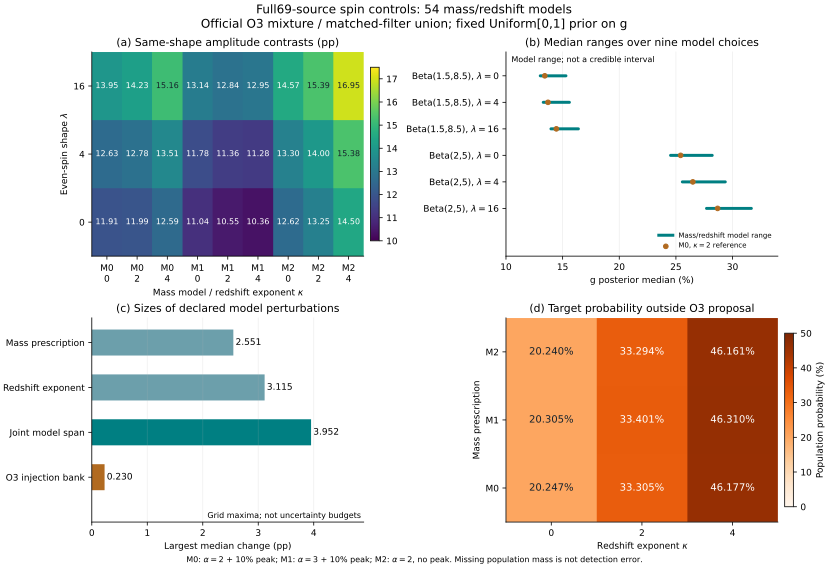

# All 69-source controls:54 mass/redshift models for negative effective spin

27 October 2026. Local research stage following the[official O3 mixture comparison](../population-mixture/README.en.md). The new design was recorded before new weights or fits. Published v0.3 papers, frozen models and workbench data remain unchanged.

**Finding: within the specified separable families, mass/redshift choices move the g posterior median by up to3.95 percentage points, while the same-shape contrast between the two magnitude families remains positive(10.36–17.14 pp). This is conditional ordering on the saved banks, not channel identification or a model-independent measurement of g.**

## Fixed inputs and tested models

All 69 events and11,180,578 original-prior posterior rows are retained. The binary-level functional is g=P(χ_eff<0), with Uniform[0,1] prior and inference conditional on N. The grid comprises:

- Three primary-mass choices:α=2+10% Gaussian peak,α=3+10% peak, andα=2 with no peak. The peak is35±5 solar masses;3≤m₁≤100 and m₂≥3, with conditional mass-ratio density proportional to q.
- Redshift exponentsκ=0/2/4 in p(z) proportional to dVc/dz×(1+z)^(κ−1), z≤2.3, using the same Planck15 grid and source coordinates.
- Magnitudes Beta(1.5,8.5) and Beta(2,5), with even-spin shapesλ=0/4/16 as in the previous control.
- Two related O3 banks(pure BBH and official four-population mixture), each under matched-filter union or union with cWB. The early O1/O2 prescription and time/trial weights are fixed.

This yields54 models and216 conditional fits. Noα/κ hyperparameter fit, event/ESS-based rejection, or model-probability weighting is performed. g is still mass/redshift independent.2PN invariance and preserved angular measure remain approximate assumptions.

## Contrasts and absolute model dependence

Each contrast subtracts the Beta(1.5,8.5) posterior median from Beta(2,5) at identical mass,redshift and even shape. All108 contrasts are positive. They are differences between separate conditional model summaries, not a difference-parameter posterior or significance statement.

| Bank:policy | Min amplitude contrast (pp) | Max amplitude contrast (pp) | All-model median range | Max mass/redshift median span (pp) |
|---|---|---|---|---|
| pure_bbh:matched_filter | 10.379573 | 17.135245 | 12.8442–31.6258% | 3.924836 |
| pure_bbh:with_cwb | 10.378579 | 16.608145 | 12.9304–31.3204% | 3.829601 |
| official_mixture:matched_filter | 10.359668 | 16.952405 | 13.0289–31.6557% | 3.952021 |
| official_mixture:with_cwb | 10.363689 | 16.496999 | 13.0399–31.3829% | 3.887517 |

The last column is the largest span across nine mass/redshift medians at fixed magnitude/shape. It is a declared model range, not a credible interval or model-average error.

All27 contrasts for the official-mixture/matched-filter case:

| Mass model | kappa | shape0 contrast (pp) | shape4 contrast (pp) | shape16 contrast (pp) |
|---|---|---|---|---|
| alpha2_peak10 | 0 | 11.912653 | 12.631061 | 13.951291 |
| alpha2_peak10 | 2 | 11.989168 | 12.784112 | 14.232472 |
| alpha2_peak10 | 4 | 12.592214 | 13.511130 | 15.162017 |
| alpha3_peak10 | 0 | 11.037441 | 11.780771 | 13.140865 |
| alpha3_peak10 | 2 | 10.549394 | 11.361257 | 12.836286 |
| alpha3_peak10 | 4 | 10.359668 | 11.283670 | 12.945228 |
| alpha2_nopeak | 0 | 12.621868 | 13.298053 | 14.567900 |
| alpha2_nopeak | 2 | 13.254794 | 14.004253 | 15.385041 |
| alpha2_nopeak | 4 | 14.502149 | 15.377945 | 16.952405 |

For that main case, changing mass prescription alone produces a maximum median span of2.551080 pp; changingκ alone gives3.115004 pp; varying both gives3.952021 pp. Bank-replacement changes at identical settings are smaller, but this does not bound actual omitted sensitivity.

| O3 policy | Largest bank median shift (pp) | Largest posterior TV |
|---|---|---|
| matched_filter | 0.230361 | 0.00899487 |
| with_cwb | 0.196748 | 0.00761517 |

TV is normalized posterior total variation on the same g functional, on0–1. Shared injection rows prevent interpreting bank differences as independent-experiment error bars.

## Model-dependent missing support

The table describes target-source probability outside the O3 proposal, not a detection fraction. Even shapes do not change this support probability. Magnitude families agree at the printed precision; all54 records are retained in results.json.

| Mass model | kappa | Pure BBH uncovered | Mixture uncovered | Added coverage (pp) |
|---|---|---|---|---|
| alpha2_peak10 | 0 | 20.309107% | 20.246934% | 0.062174 |
| alpha2_peak10 | 2 | 33.407531% | 33.305258% | 0.102273 |
| alpha2_peak10 | 4 | 46.318547% | 46.176749% | 0.141798 |
| alpha3_peak10 | 0 | 20.309107% | 20.305284% | 0.003823 |
| alpha3_peak10 | 2 | 33.407531% | 33.401242% | 0.006288 |
| alpha3_peak10 | 4 | 46.318547% | 46.309828% | 0.008719 |
| alpha2_nopeak | 0 | 20.309107% | 20.240026% | 0.069082 |
| alpha2_nopeak | 2 | 33.407531% | 33.293894% | 0.113636 |
| alpha2_nopeak | 4 | 46.318547% | 46.160994% | 0.157553 |

Acrossκ=0 to4, the official mixture still misses about20.24%–46.31% of target probability. The trivial p_det≤1 omitted-selection upper bound is about30–1702 times a represented component, so it does not certify negligible omissions. Actual omitted efficiency is unmeasured.

The maximum difference between the fixed-grid trapezoid normalization and a refined piecewise integral is8.29e-8. Support probabilities use the continuously interpolated target with its integral renormalized; posteriors preserve the old numerical protocol. The global target normalization cancels in the likelihood conditional on N.

## Validation and limits

The independent validator rereads all 69 raw posterior caches, reconstructs the PE prior with a separate flat-LambdaCDM integral, forms Cartesian-spin densities for all54 targets, sums original HDF injections and multiplies all 69 event factors. It does not import the producer weights/posterior. Maximum relative event-integral difference is2.17e-9; relative selection2.34e-15; peak-scaled density1.13e-10; absolute quantile1.40e-11; support probability6.67e-16. All pass the gates recorded before calculation. The fixed target cosmology grid is intentionally shared; this is implementation verification, not independent observations.

Minimum event weight ESS is about107.9 and minimum pooled selection concentration ESS about1508.3. Neither certifies full MC error or actual-campaign coverage. GW191204_171526 still has zero saved negative-component integrals under all54 models; reweighting does not recover unseen components. This study has not repeated the prior512 paired thinnings across all54 models, and does not repurpose those six-model ranges as new-model error bars.

## Prior work and next evidence

Parametric-spin shape bias and enlarged uncertainty with flexible models are already addressed by [Golomb & Talbot](https://arxiv.org/abs/2210.12287v2). Mass-ratio/effective-spin covariance is studied by [Adamcewicz et al.](https://arxiv.org/abs/2307.15278v2) (abstract/version checked here). This does not claim that mass-model sensitivity is new. The increment is the source-complete 69-event, explicit-prior, two-bank/two-policy, 54-model comparison with independent numerical checks.

Mass/redshift-dependent g or more general parameter correlations remain to be tested: this factorized grid cannot settle them. Common spin reference, missing event likelihood, omitted detection probability, actual historical injection protocol, waveform systematics and physical-channel predictions remain unfinished. Positive median contrasts must not be promoted into channel evidence.

## Reproduction

First restore the full 69 event caches and official O3 mixture data via the[reproduction guide](../REPRODUCING_POPULATION.md). Scientific versions are recorded in results.json and pinned in population-requirements.txt; plotting also needs Matplotlib. Raw posteriors,HDF and NPZ checkpoints remain local/ignored. event-integrals.json holds only derived integrals/source hashes. Version the cache when its density protocol changes.

```text
python research/population-mass-redshift/run_grid.py
python research/population-mass-redshift/validate_grid.py
python research/population-mass-redshift/plot_grid.py
python research/population-mass-redshift/summarize_grid.py
```
[Before-fit design](design.json) · [All results](results.json) · [Independent validation](validation.json) · [Vector PDF](mass-redshift-comparison.pdf)


