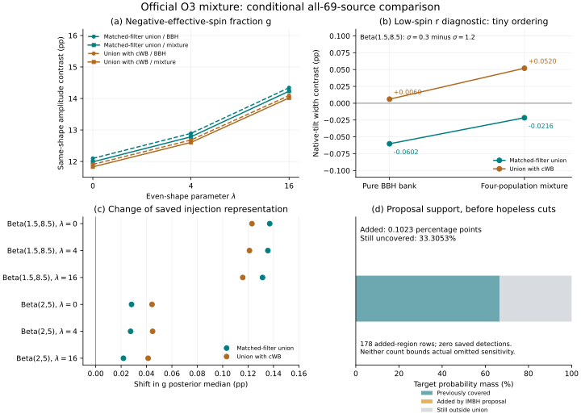

# 官方 O3 混合注入：全69来源的条件对照

2026-10-27。目标恢复运行后新增的本地阶段研究；已公开的 v0.3 论文与结果保持不变，本结果尚未并入该论文或工作台。

我们从[固定官方发布7890437](https://zenodo.org/records/7890437)读取推荐的四类总体混合注入，替换原来纯BBH的O3选择项。全69事件的原始先验积分、两个六模型族、早期O1/O2项及观测时间比例保持固定。数据中共有1,141,491条接受注入，总生成数86,318,296；284,672条原BBH行全部找到唯一精确连接，40个共用物理/搜索字段逐项相同。

**阶段结论：对这次官方注入表示替换，g 后验变化小于所测试的幅度模型差；原生r的小排序仍依赖搜索口径。混合文件并未解决目标支持不完整。** 这是相关固定银行上的比较，不是独立敏感度测量或真实MC误差校准。

## 后验与模型对比

pp 为百分点。TV 是归一化后验之间的总变差距离（0–1），没有把不同科学指标相减。下表范围只覆盖保存的5/50/95分位数，不表示所有可能分位数的上界。

| Metric | O3 policy | Max \|median shift\| (pp) | Max \|5/50/95 shift\| (pp) | Max posterior TV |
|---|---|---|---|---|
| g | matched_filter | 0.137027 | 0.196019 | 0.00543130 |
| g | with_cwb | 0.123030 | 0.176349 | 0.00488616 |
| r | matched_filter | 0.068321 | 0.137374 | 0.00977059 |
| r | with_cwb | 0.074574 | 0.146202 | 0.01042921 |

g 对比为相同 λ 下 Beta(2,5) 减 Beta(1.5,8.5) 的后验中位数；r 对比为同一幅度族下 σ=0.3 减 σ=1.2。g=P(χ_eff<0)，r=P(cos θ₁<0)，二者均不是已识别的形成渠道比例。

| Metric | O3 policy | Shape / magnitude | Pure BBH (pp) | Mixture (pp) |
|---|---|---|---|---|
| g | matched_filter | 0 | +12.097983 | +11.989168 |
| g | matched_filter | 4 | +12.892206 | +12.784112 |
| g | matched_filter | 16 | +14.342024 | +14.232472 |
| g | with_cwb | 0 | +11.907912 | +11.829218 |
| g | with_cwb | 4 | +12.682254 | +12.605962 |
| g | with_cwb | 16 | +14.092920 | +14.018385 |
| r | matched_filter | Beta(1.5,8.5) | -0.060242 | -0.021579 |
| r | matched_filter | Beta(2,5) | +6.353620 | +6.383751 |
| r | with_cwb | Beta(1.5,8.5) | +0.006044 | +0.052012 |
| r | with_cwb | Beta(2,5) | +6.293535 | +6.331654 |

两种搜索口径下，混合文件全部新支持区域的已保存检出贡献均为零，所以完整混合与限制在原BBH提议支持内的选择结果相同。这个数值恒等不等于新区域的真实检出概率为零。原BBH行与混合行并非独立，不能把两估计之差当统计显著性。

## 新覆盖很小，未覆盖仍然存在

在固定目标 m₁≤100、m₂≥3 M☉ 下，BNS/NSBH提议不能增加支持；IMBH提议只在 m₁≥90、m₂≥10 M☉ 的高质量区域补上1.9<z≤2.3。这个质量区域占给定目标质量分布0.306136%，因此总共只增加0.102273个百分点的总体概率质量。混合提议仍未覆盖33.305257%的目标概率质量；这里是源总体质量，不是检出比例或选择函数误差。

新增目标支持中保留了178条注入，匹配滤波及含cWB并集均没有保存的检出行。它们来自有权重的提议和hopeless筛选，不能直接套用“178次独立目标抽样零检出”的二项上界。

后续来源诊断还发现：在只有BBH提议有支持的260,145条重叠行上，官方混合联合密度不严格等于独立BBH联合密度乘生成数比例；相对残差最大6.4486%，中位比值约0.9999995。可能的数值构建原因尚未核实，本研究保留各文件声明的联合密度，没有硬设两者相等。这是事后来源诊断，不是恢复了原始生成配置。

## 验证、文献位置与复现

独立脚本从HDF直接重建Cartesian目标/联合提议密度比、早期与O3积分、69事件完整乘积后验；没有调用生产脚本的权重或后验函数。最大选择相对差8.89e-15、相对峰值密度差1.94e-12、分位数差4.17e-15。支持质量另以分段多项式/Gauss–Legendre积分核对，绝对差4.14e-10。这验证数值实现，复用的事件积分仍是原来的输入，不是独立观测。

使用混合注入和混合权重遵循官方说明及[Essick 2021](https://doi.org/10.3847/2515-5172/ac2ba7)，不作为新方法。Hopeless cut、真实噪声和半解析近似的限制参照[Essick 2023](https://arxiv.org/html/2307.02765v1)。本轮增量是对本项目全部69来源/12个模型的具体对照、精确行连接、后验距离及剩余支持量化。

需要固定原始数据与已有全69事件缓存，依赖仓库 population-requirements.txt；图另需Matplotlib。原HDF、行映射和数值检查点不随Git分发，下载清单保留官方MD5与本地SHA256。仅下载本轮文件不能代替恢复前序研究输入。

```text
python research/population-mixture/fetch_mixture.py
python research/population-mixture/inspect_mixture.py
python research/population-mixture/study_mixture.py
python research/population-mixture/validate_mixture.py
python research/population-mixture/plot_mixture.py
python research/population-mixture/summarize_mixture.py
```
[Results](results.json) · [Independent calculation](validation.json) · [Source audit](provenance.json) · [Before-comparison design](design.md) · [Vector PDF](mixture-comparison.pdf)


