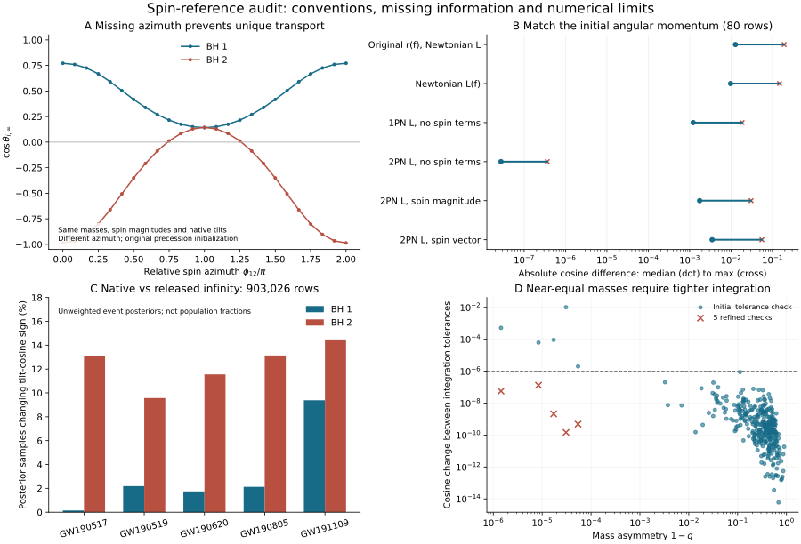

# 阶段九：自旋参考转换的定义与数值核验

2026-10-25。五个原始先验事件，903,026条公开后验样本；80条诊断样本与350条不同源行的验证样本。当前成果是自旋转换的可核查实现与信息完整性审计，尚未完成共同参考下的群体推断。

## 主要结果

1. 五份HDF都保存相对自旋方位角`phi_12`、原生倾角、探测器质量和`*_infinity_only_prec_avg`。教学NPZ没有方位角，也没有参考频率，不能仅用其七个物理坐标唯一恢复无穷远倾角。
2. precession 2.1.2默认的频率→分离→牛顿角动量初始化，与公开字段所兼容的2PN非自旋角动量初始化不同。80条源行上，前者与公开倾角余弦的最大差为0.19221；使用后者后降为3.6233e-7。
3. 另选350条源行验证，其中320条按固定种子随机选取，30条为预先规定的边界压力样本。初次普通/加严容差比较暴露5条近等质量问题；进一步加严后，350条与公开字段的最大余弦差为4.7186e-7，最终两容差最大差8.7748e-7，kappa回程误差最大9.4080e-10。保留初次失败与全部后续积分结果，不隐藏边界问题。
4. 该一致性只验证约定匹配后的数值实现；不证明纯进动平均近似在探测器频段具有同等物理精度，也不替代混合轨道平均演化。注入自旋的原生参考仍未恢复。



图A是固定输入反例；图B比较80条诊断行上的六种初始化；图C是全部原始事件后验的逐行符号穿越；图D保留350条验证行的初次容差差异及5条后续收敛检查。图C不是群体占比，图B/D不是物理误差置信区间。

## 数据与计算协议

| 事件 | 原始先验后验行数 | 原生参考Hz |
|---|---:|---:|
| GW190517_055101 | 161299 | 20 |
| GW190519_153544 | 150207 | 10 |
| GW190620_030421 | 152410 | 10 |
| GW190805_211137 | 169040 | 10 |
| GW191109_010717 | 270070 | 20 |

均来自已在阶段五/七核验的`C01:IMRPhenomXPHM`标签。提取程序先核验各HDF的SHA256，保持零基源行号，再检查有限性、Cartesian自旋与phi_12的余弦一致性、倾角余弦与有效自旋关系。全部903,026行有效；公开无穷远字段与原生chi_eff之差最大约5.6e-16。

[spin-provenance.json](spin-provenance.json)给出字段、频率、源文件散列与核验；[historical-metadata.json](historical-metadata.json)保留五份HDF的演化入口及环境版本。HDF均标记precession_averaged及hybrid_spin_evolution入口v1；环境记录LALSuite 7.0及三个PESummary版本。环境字符串不等于已恢复全部历史运行源码。

先从每事件按源行均匀取16条，共80条诊断行。发现初始化差异后，固定2PN非自旋L约定；用种子20261025从各事件排除诊断行后无放回抽64条，再加六种输入极值行：q、a1、a2、探测器总质量、两颗黑洞的平面内自旋幅度。每事件得到70条互不重复行，共350条。压力行并非随机样本，不将其失败比例推广到全后验或宇宙群体。

## 为什么初始化不同会造成差异

令v=(pi M_detector f_ref)^(1/3)，质量以时间单位表示，eta=q/(1+q)^2。与公开字段相符的控制采用

```text
L_2PN = eta/v * [1 + (3/2 + eta/6)v^2
                    + (27/8 - 19 eta/8 + eta^2/24)v^4]
r_effective = (L_2PN/eta)^2
```

这里r_effective只是把同一个初始L交给precession方程的参数化，不把它称为真实轨道半径。保留原生倾角和phi_12；沿用同一进动平均方程演化至无穷远。

独立对照还计算牛顿频率L、1PN非自旋L、2PN含自旋项的L模以及完整L矢量旋转。仅2PN非自旋L把诊断集误差压至亚微量级；这不是拟合系数，全部系数来自PN公式。完整L矢量会改变原生自旋的投影轴，因此其chi_eff与原生定义可以不同；不能用同一名字隐藏轴的变化。

[LALSuite 7.26固定文档中的混合演化入口](https://lscsoft.docs.ligo.org/lalsuite/7.26/lalsimulation/hybrid__spin__evolution_8py_source.html)在`prec_only`分支明确传入`LPNorder=2,LPNspins=False`（第231–238行）；[同版本角动量源文档](https://lscsoft.docs.ligo.org/lalsuite/7.26/lalsimulation/calc__tilts__prec__avg__regularized_8py_source.html)提供公式与约定。[PESummary v0.13.0入口](https://github.com/pesummary/pesummary/blob/v0.13.0/pesummary/gw/conversions/evolve.py)把precession_averaged映射到该prec_only分支。公式独立实现；下载的外部源码仅用于阅读，未复制执行或随仓库发布。

这形成了“历史HDF元数据＋固定版本入口说明＋独立数值吻合”的证据链。但7.26文档不是7.0历史环境的逐字副本；尝试读取历史tag的源码返回404，不能声称已重建原执行环境。

## 数值边界与失败记录

precession 2.1.2的`integrator_precav`检查`rol/aol`而非`rtol/atol`，会覆盖传入容差；因此仅改变参数再调用原入口不能验证收敛。我们保留上游库不改，另用SciPy DOP853积分其公开`rhs_precav`，执行真正的容差扫描与kappa回程检查。默认只请求确定性守恒量，避免有限分离角度的随机进动相位重采样。

初次验证对比rtol/atol=1e-9/1e-11与1e-11/1e-13。五条q约0.99995–0.999999的压力样本触发余弦差>1e-6或回程kappa误差>1e-7。其中最大余弦差0.01009；最接近等质量的一条在加严计算下与公开字段仍差4.60e-4，回程误差2.65e-5。

随后对全部触发行统一计算1e-12/1e-14、1e-13/1e-15、3e-14/3e-16三个容差层次。最终两层次收敛到上述指标。中间层一次出现“too close to resonance”的RHS修正警告，保留在[equal-mass-results.json](equal-mass-results.json)和[reference-audit.json](reference-audit.json)；最终两层次未产生该警告。不能把整个试验描述成“从未警告”。

这里的1e-6余弦、1e-8回程门槛是固定样本上的工程检查，不是全参数域误差界或覆盖率校准。接口明确拒绝q=1、零自旋及缺少原生参考等未支持情形；这是研究适配器，尚不能自动处理整个目录。

## 缺失方位角不是可忽略的小字段

固定theta1=1.1、theta2=2弧度，q=0.65，a1=0.7，a2=0.6，Mdet=80太阳质量，fref=20Hz；只扫phi_12。使用原precession初始化，主黑洞无穷远倾角余弦范围0.1415–0.7712，次黑洞为-0.9863–0.1441。相同教学坐标对应多种演化结果，所以补零不是数据恢复。这个反例只证明非唯一性，不估计真实群体的偏差大小。

原始五事件的全后验统计也显示不少样本穿过cos(theta)=0；双向穿越可以互相抵消，所以穿越比例不能等同于负倾角比例的净变化。单事件后验又不能直接当内禀群体分布。

## 与已有研究的关系

[Mould & Gerosa, 2110.05507v2](https://arxiv.org/html/2110.05507v2)的II–III节已经讨论共同过去无穷远参考及选择效应。统一20Hz仍不等于统一动力学阶段。我们阅读其方法并借用此问题定义，没有把其半解析选择模型的参考频率强加到官方O3注入。

[precession v2, 2304.04801](https://arxiv.org/abs/2304.04801)提供既有演化方法。当前增量限定为本项目输入的数据谱系、初始化约定对照、缺失信息反例与数值边界记录，不宣称发现新进动物理或新的形成渠道比例。

## 复现

先按阶段五/七说明恢复五份原始先验HDF及源清单。`extract_spins.py`需要h5py；绘图需要matplotlib；网络取证需要requests。演化独立环境固定在[requirements.txt](requirements.txt)：Python3.12、NumPy1.26.4、SciPy1.13.1、precession2.1.2。NumPy2.5不兼容该版precession的部分标量转换，不能无条件换用主Python。

从仓库根目录依次运行（命令中的python分别选择相应环境）：

```text
python research/population-reference/fetch_sources.py
python research/population-reference/extract_spins.py
python research/population-reference/study_reference.py
python research/population-reference/diagnose_initialization.py
python research/population-reference/validate_reference.py
python research/population-reference/probe_equal_mass.py
python research/population-reference/summarize_reference.py
python research/population-reference/plot_reference.py
```

演化四个命令为study_reference、diagnose_initialization、validate_reference、probe_equal_mass。其余命令可使用分别具备依赖的现有环境。下载来源与校验和位于[sources/manifest.json](sources/manifest.json)，来源变化会失败而不是覆盖既有证据。NPZ、HTML/源码快照、环境目录和PNG仅留本机；JSON、独立脚本与SVG保留为可发布材料。尚未执行洁净机器端到端复现。

## 下一步门槛

全目录需获得相对方位角及每事件原生频率，注入需恢复可查证的参考定义；二者必须一起变换。先验/群体密度的坐标测度也要保持一致，不能只替换倾角列。若使用更准确混合演化，需要事件与注入采用配套精度。当前`common_reference_population_ready=false`仍正确；本阶段完成的是数值和定义核验，不是该科学门槛。
