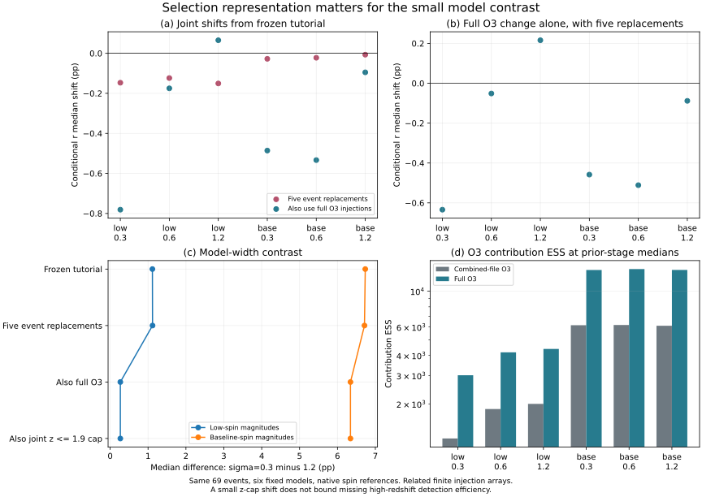
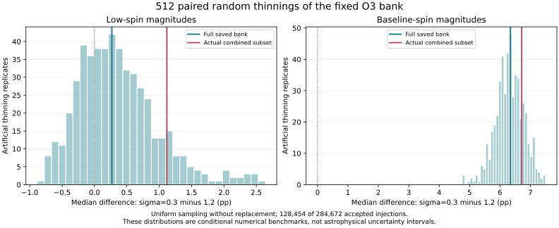

# 阶段八：完整O3选择积分与有限样本表示

2026-10-25。完成完整O3注入来源、时间/生成数归一化、六模型传播和条件抽稀基准。**低自旋幅度组的小模型差异对注入样本表示敏感**：在五事件原始先验表示固定后，σ=0.3与1.2的r中位数差从1.11855缩小到0.26840个百分点。基线幅度组的较大差异由6.71305变为6.34298个百分点。两组均不能直接解释成形成渠道比例。

已取得固定[官方说明](https://zenodo.org/records/7890398/files/o1%2Bo2%2Bo3-sensitivity-estimates.md?download=1)，验证公开MD5和SHA256，记录于[sources/manifest.json](sources/manifest.json)。这份说明确认O1/O2是固定PSD下IMRPhenomXPHM的半解析SNR近似，O3另提供真实噪声中的搜索统计量；单次运行中的不同注入子集并非使用同一抽样分布，文档没有展开其逐一细节。

[metadata-audit.json](metadata-audit.json)检查原始合并BBH注入HDF。它保存Cartesian spins，但没有自旋参考字段，头部只有三个汇总属性。随后已通过官方API取得固定[O3-only发布7890437](https://zenodo.org/records/7890437)的说明、示例notebook和88,842,240字节BBH摘要，全部验证公开MD5和SHA256。只读取notebook文本，没有执行上游代码。

## 完整O3来源与归一化

[o3-provenance.json](o3-provenance.json)确认：

- 完整O3文件保留284672条接受注入，声明总生成73957576=284672+73672904，时长28749576秒。
- 合并文件中的128454条O3样本全部唯一匹配完整文件，质量、红移、自旋、搜索统计量及联合sampling_pdf严格相等。只有mixture_weight不同。
- 原IFAR>1年规则在完整文件选出81117条，在合并O3子集选出36468条。O1/O2的选择规则保持原样。
- 声明O3 BBH提议为m1∈[2,100]、m2∈[2,m1]，幂次−2.35和+1，自旋幅度均匀到0.998、方向各向同性，z≤1.9且pow_z=1，使用LAL Planck15宇宙学。
- 新文件仍没有自旋参考频率。原生成项目链接的固定提交尚未取得，不能把O4文献的16 Hz赋给O3。

完整O3贡献按`(T_O3/T_all)/N_O3 * sum_detected[p_pop/p_draw]`计算，O1/O2保留合并文件的精确mixture_weight。恢复的实际抽稀比例与时间/生成数/mixture_weight满足代数恒等式，误差2.22×10⁻¹⁶；这确认归一化的一致性，不证明历史抽稀算法是独立均匀抽样。

红移抽样密度必须按1001点网格线性插值重建，最大相对误差4.82×10⁻¹³。直接用连续宇宙学公式替代，在最低红移行可偏离约10.7%。质量和自旋原始坐标为float32，重建分因子受舍入限制；实际积分保留官方sampling_pdf。对完整与合并文件先统一浮点精度再计算自旋模和质量比，避免同值坐标因dtype产生额外差异。

## 条件后验变化

同一69事件、同一共同r先验、六模型；五个事件采用阶段七完整原始先验样本。仅恢复完整O3注入后的变化如下。

| 自旋幅度/倾角宽度σ | r中位数变化(pp) | O3贡献ESS：子集→完整 |
|---|---:|---:|
| 低自旋 / 0.3 | −0.63428 | 1220 → 3012 |
| 低自旋 / 0.6 | −0.05131 | 1859 → 4176 |
| 低自旋 / 1.2 | +0.21586 | 2001 → 4386 |
| 基线幅度 / 0.3 | −0.45837 | 6150 → 13529 |
| 基线幅度 / 0.6 | −0.51130 | 6170 → 13717 |
| 基线幅度 / 1.2 | −0.08829 | 6102 → 13547 |

原始O3项占总选择积分约85%–86%。精确mixture_weight修正本身只产生约10⁻⁷个百分点量级的中位数变化，无法解释上述效应。全部结果见[selection-results.json](selection-results.json)。



## 红移支持检查

O3提议止于z=1.9，模型止于2.3；合并O1/O2虽然有更高红移行，也不能证明O3尾部检测效率为零。总体红移分布在1.9–2.3的概率质量，对λ=0/2/4分别为20.31%/33.41%/46.32%。这是总体源的质量，不是检出比例。

将事件积分与选择积分**同时**限制到z≤1.9后，六设定最大中位数变化约0.000159个百分点；显式重新归一化总体模型与省略共同常数的计算相同。该小变化只描述当前已保存样本，不能限制未采样O3高红移检测尾部。该支持问题保持未解决状态。

## 条件无放回抽稀基准

在上述结果之后记录追加设计，用完整已接受银行作为有限总体，以固定种子20261025均匀无放回抽取与历史子集同样大小的128454行，重复512次；失败检测贡献为零，六模型共享每次抽样行。由全银行到子集的校正保留总和估计的期望。见[thinning-results.json](thinning-results.json)。

| 幅度组 | 完整银行模型差(pp) | 实际子集模型差(pp) | 人工抽稀5%/50%/95%分位数(pp) |
|---|---:|---:|---:|
| 低自旋 | 0.26840 | 1.11855 | −0.49522 / 0.27300 / 1.48697 |
| 基线幅度 | 6.34298 | 6.71305 | 5.55808 / 6.31224 / 7.08646 |

低自旋组差值在人工抽稀中可以变号。实际子集差值位于这两个条件分布约89%与80%分位；这些位置不是p值。协方差采用有限总体修正`(1−n/M) S/n`，用五行小银行穷举验证到4.44×10⁻¹⁶；512次经验方差/解析方差比为0.896–1.023。

该实验只校准**声明的人工抽稀协议**。历史抽稀机制尚未恢复；完整银行也不是无限精度真值。因此这些分位区间不是天体物理可信区间，也不是原注入活动的完整MC误差条。



## 独立核验与下一步

[selection-validation.json](selection-validation.json)用完整69事件乘积重算，最大分位数差1.22×10⁻¹⁵；全部接受行加检测指示函数重算选择积分误差2.22×10⁻¹⁶；精确子集重建O3贡献误差9.10×10⁻¹⁵；网格加密差1.35×10⁻⁷以内。冻结模型及两份NPZ输入未改变。

研究判断需要相应收紧：阶段七证明的只是固定选择函数下的表示对照；恢复完整O3后，小模型差异明显缩小，不能以原数值作为稳定物理效应。较大幅度组差异在当前检验中保留，但共同自旋参考、目录与搜索阈值一致性、hopeless cut、O3高红移支持及完整采样误差仍需研究。下一步优先完成这些定义与校准，再更新双语论文和工作台。

正式比较自旋参考定义前，不把所有注入擅自当成20 Hz，也不把一个与频率有关的元数据缺口用普通默认值填上。若开展分层经验扰动，仍须将其标记为固定保留样本条件下的诊断。

复现（下载需网络；提取需h5py；数值部分需NumPy/SciPy/Astropy；绘图需matplotlib）：

```text
python research/population-selection-audit/fetch_definition.py
python research/population-selection-audit/inspect_metadata.py
python research/population-selection-audit/fetch_o3_definition.py
python research/population-selection-audit/fetch_o3_bbh.py
python research/population-selection-audit/extract_o3.py
python research/population-selection-audit/run_selection_study.py
python research/population-selection-audit/validate_selection.py
python research/population-selection-audit/thinning_benchmark.py
python research/population-selection-audit/plot_selection.py
```

数值步骤还需阶段五、七缓存。来源说明、HDF、NPZ及PNG预览不随仓库发布；新增派生结果单独保存，不覆盖冻结选择积分、旧论文或旧图。方法重叠见[文献对照](literature-context.md)。
## 后续：搜索管线口径

2026-10-25补充：[pipeline-policy.md](pipeline-policy.md)量化LVK附录A不含cWB的BBH灵敏度规则。完整O3的2253条仅cWB检出对总选择积分有模型依赖贡献；固定69候选事件时，两组倾角宽度中位数差变为0.18579/6.40308个百分点。此前含cWB的抽稀区间不直接适用于新规则。以上保留完整O3表示研究的原始记录。

后续已完成两种规则共享512次抽稀、协方差和单行影响诊断，见[paired-policy.md](paired-policy.md)；低自旋匹配滤波差值在35.55%的人工抽稀中非正，比例不是天体物理概率。

另完成[累计O1/O2/O3发布对照](cumulative-control.md)：逐行身份、混合权重和独立Cartesian核验；发现早期观测SNR的约8.5保存下界，分开记录保留行掩码结果与尚未恢复生成配置的截断模型假设。新版观测规则下差值为0.41338/6.58834 pp；不能把新旧发布之差全归因于噪声。
