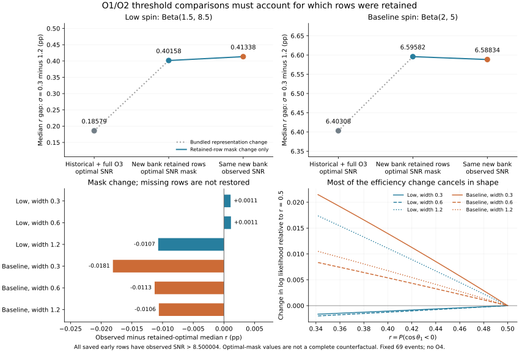
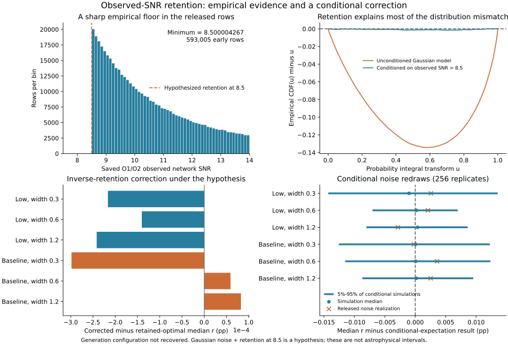

# O1/O2/O3 累计注入发布：保留样本、噪声判据与条件对照

2026-10-25。沿用69个事件、五事件完整原始先验替换、六种模型、共同均匀先验上的 `r=P(cos tilt1<0)`。不增加O4事件或O4注入，不覆盖冻结结果。

## 已确认的数据事实

固定来源为[LVK累计灵敏度发布16740128](https://zenodo.org/records/16740128)的 `mixture-semi_o1_o2-real_o3-cartesian_spins_20250503134659UTC.hdf`，257339480字节，SHA256 `89f912ba2e207f56455df9628d4b3fab76cd8d7924ea7f1263a16119bce1ab31`。官方MD5已核对。

文件含919033行，其中593005行为非零半解析观测SNR的O1/O2行，326028行为O3真实注入。两个时间段不重叠，早期行全部O3 FAR为无穷大，与官方字段说明一致。全文件并不限于BBH；646167行在本项目质量支持内，其余行的模型权重为零。总生成数697580768，总分析时间43151200秒。

以源质量m1与红移的精确唯一键连接，旧完整O3 BBH文件中117259行出现在新版O3中。交集行的两质量、红移、六自旋分量逐值相等；五管线的IFAR倒数与新版FAR相符到1.12e-16，阈值判定无不一致。**这是交集行的身份核验，不表示新文件完整包含旧BBH银行。** 详见[cumulative-provenance.json](cumulative-provenance.json)。

采用官方 `weights / total_generated`，将Cartesian联合抽样密度乘以 `m1 (2 pi a1^2)(2 pi a2^2)`，转到本项目质量比、幅度和倾角余弦坐标。O3固定采用四个匹配滤波搜索的 `FAR<1/year` 并集。采用官方早期观测SNR>10规则时，源文件层面369995条早期行、219071条O3行通过；这些是全混合源计数，不是重加权后的BBH检出数。

## 第一层结果：不同文件和保留行掩码

下表比较宽度0.3与1.2的r后验中位数之差，单位为百分点（pp），不等于形成渠道比例。

|选择表示|低自旋 Beta(1.5,8.5)|基线幅度 Beta(2,5)|
|---|---:|---:|
|历史O1/O2 + 完整旧O3，匹配滤波|0.185794|6.403081|
|新版文件的保留行上，最优SNR>10|0.401582|6.595824|
|新版文件，观测SNR>10|0.413382|6.588337|

第一行到后两行同时改变了样本银行、提议分布、权重、覆盖和时间表示，不能称为单一噪声效应。总时间乘到整个选择函数的共同常数会在条件形状推断中抵消，但时间在各运行之间的相对分配不会如此抵消。

**第二行也不能直接当成完整“最优SNR判据”的估计。** 进一步检查发现所有保存的早期观测SNR都大于8.500004267。最优SNR大于10、但观测SNR落到这个保存门槛以下的行可能已经不在文件里。因此第二、三行之间六模型最大0.018092 pp的中位数差，只是保留行上的掩码对照。`cumulative-results.json` 保留兼容键 `cumulative_optimal`，其范围字段已明确这一限制。



## 第二层：显式提出并检验一个保存机制假设

假设早期网络噪声为独立高斯正交分量：

`R^2 | rho_opt ~ ncx2(df=2*N_IFO, nc=rho_opt^2)`，且行保留条件为 `R>8.5`，另外可能存在只依赖源参数的预筛选。

这是依据[Essick 2023](https://arxiv.org/html/2307.02765v1)的噪声分布模型和保存数据最小值提出的**待确认生成假设**。没有取得这份累计文件对应的原始生成配置；论文所列GitLab源码入口本轮未成功读取。不能把8.5写成已经恢复的官方参数，也不能把该文的原理说成本项目的方法创新。

后续已通过公开GitLab API取得固定历史源码，并用Git blob散列验证。其高斯正交分量、2*N_IFO自由度及条件筛选之外的生成密度实现与上述模型相符，见[generation-source-audit.json](generation-source-audit.json)。这加强了实现依据，但仍未取得累计活动实际执行配置或8.5参数；此前入口读取失败不再是当前状态。

数据内174176条早期行为两探测器网络，418829条为三探测器网络，正的H/L/V最优SNR分量决定网络维数；网络SNR与分量平方和一致。对观测SNR作概率积分变换：

- 不考虑保存条件，经验CDF与均匀CDF的最大距离为0.134516。
- 考虑 `R>8.5`，距离降为0.001682；两种网络分别为0.002867、0.001701。
- 在这一条件模型下，观测SNR>10的行数残差分别为1.684和0.299个条件标准差。

这说明截断模型与数据相容得多，但无法证明不存在其他筛选。由于8.5由本批数据提示，以上是描述性拟合检查，不报告为预注册假设检验的显著性。

令 `s(theta)=P(R>8.5 | theta)`。若上述机制成立，且官方抽样密度/混合权重仍对应保留前参数抽样，则可利用逆保留概率恒等式：

`E[I(R>8.5) f(theta)/s(theta)] = E[f(theta)]`。

我们只对最优SNR>10的行作这个补偿，其s范围为0.951832到1，避免在全银行最小s约0.000537处放大权重。另用 `P(R>10|theta)/s(theta)` 计算固定保留参数下的观测判据条件期望。它们没有补回参数支持之外的区域或未知源参数预筛选。

|量，六设定中的最大绝对中位数变化|百分点|
|---|---:|
|假设成立时，补偿最优SNR掩码的漏行|0.0002982|
|观测条件期望相对补偿后的最优SNR估计|0.0175882|
|公开观测噪声实现相对条件期望|0.0035873|

在同一假设下，用固定种子20261026，对保留源参数重新抽取256次满足R>8.5的噪声阈值指示；所有六模型共享每次随机行指示，O3项固定。六模型中位数的条件标准差为0.00463–0.00815 pp。这不是重新生成整个注入活动，也不是天体物理可信区间。



## 独立核验与解释边界

`validate_cumulative.py` 从官方HDF直接用Cartesian总体密度求和，不调用生产坐标转换、权重或后验函数。共享已指定的宇宙学插值表与事件均值，独立实现质量雅可比、自旋体积元及完整事件乘积；选择积分最大相对差4.93e-14，后验分位数最大差9.33e-15。1001到2001点加密差不超过1.33e-7（r单位）。

`validate_retention.py` 用Poisson混合Gamma尾积分独立核对非中心卡方尾概率，最大相对差1.14e-13；对三行Bernoulli加权和穷举全部八个结果，协方差差5.56e-17。256次噪声模拟的经验/解析方差比为0.923–1.331；保留这一有限重复数散布，不把数值检查描述成完整覆盖率验证。

当前可支持的结论是：**本次六设定中的小幅阈值差异，在一个与数据相容的保存机制假设下仍然很小；但“新版本差异=噪声效应”的归因不成立。** 保存门槛、检测门槛与参数预筛选必须分别检查。尚未解决生成配置的身份、O3高红移支持、共同自旋参考、完整PE先验支持和全活动MC误差；这一步不宣布最终形成渠道推断稳健。

## 复现

需要此前选择函数及五事件缓存。提取/独立HDF校验使用含h5py的环境，主计算使用NumPy/SciPy/Astropy，绘图使用matplotlib。

```text
python research/population-selection-audit/fetch_cumulative.py
python research/population-selection-audit/inspect_cumulative.py
python research/population-selection-audit/cumulative_control.py
python research/population-selection-audit/validate_cumulative.py
python research/population-selection-audit/cumulative_retention.py
python research/population-selection-audit/validate_retention.py
python research/population-selection-audit/plot_cumulative.py
python research/population-selection-audit/plot_retention.py
```

原始HDF、NPZ及PNG不发布；派生JSON、SVG、脚本与本记录单独保存。

## English research note

We audited the O1/O2/O3-only subset of the fixed LVK cumulative sensitivity release. An exact join identified 117,259 unchanged O3 BBH injections, but the cumulative product is not the complete historical BBH bank. With the documented observed-SNR threshold, the two conditional width-model gaps are 0.41338 and 6.58834 percentage points. Comparing this with the historical representation bundles multiple changes.

All saved early-run observed SNRs exceed 8.500004, so applying an optimal-SNR threshold only to retained rows does not establish the complete deterministic-threshold counterfactual. A hypothesized Gaussian-noise model conditioned on observed SNR>8.5 closely describes the saved noise distribution. Under that explicitly unconfirmed retention law, inverse-retention correction changes medians by at most 0.000299 pp, and conditional expected observed-versus-corrected-optimal selection changes medians by at most 0.01759 pp. These checks neither recover historical generation metadata nor establish full injection-campaign coverage. The fixed-parameter conditional noise simulations are not astrophysical uncertainty intervals.
