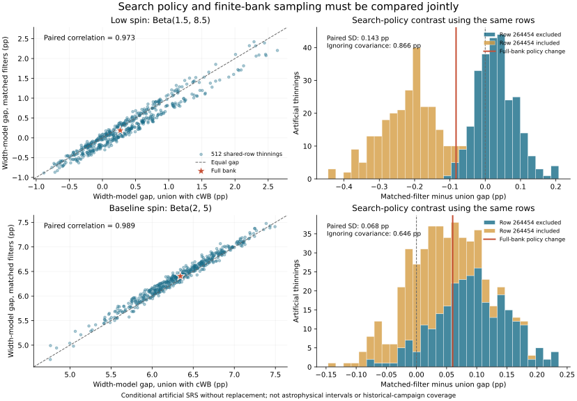

# 配对搜索规则、抽稀与高影响注入

2026-10-25。接续搜索口径对照，明确采用512次均匀无放回抽样：从完整O3的284672条接受注入中保留128454条，种子20261025。两个搜索规则、六个模型、两个群体分量共享同一组源行，未检出注入贡献为零。事件和O1/O2固定。

这组实验只条件于已保存银行及指定的人工抽稀设计，不标定历史实际抽样机制，不把其区间称为天体物理可信区间。每次含cWB规则的选择积分与分位数均逐项恢复阶段八的结果，分位数回归误差0。

## 模型差与搜索口径的共同波动

差值定义为同一幅度先验下sigma=0.3减sigma=1.2的r后验中位数，以百分点计。r的定义和共同先验沿用阶段七。

| 幅度先验 / 搜索规则 | 完整银行差值 | 人工抽稀5/50/95%分位数 |
|---|---:|---|
| Beta(1.5,8.5)，含cWB | 0.26840 | -0.49522 / 0.27300 / 1.48697 |
| Beta(1.5,8.5)，匹配滤波 | 0.18579 | -0.56305 / 0.19559 / 1.40760 |
| Beta(2,5)，含cWB | 6.34298 | 5.55808 / 6.31224 / 7.08646 |
| Beta(2,5)，匹配滤波 | 6.40308 | 5.60222 / 6.38289 / 7.09740 |

低自旋组匹配滤波差在35.546875%的指定抽稀重复中不大于零；该比例不是形成渠道概率，也不是检验零假设的p值。基线幅度组在这些重复中保持正差，但仍不证明跨所有模型的物理结论。

定义搜索规则效应为匹配滤波差减含cWB差，两组完整银行效应分别为-0.08261/+0.06011 pp。两规则的抽稀结果高度相关，相关系数0.9731/0.9892。配对效应标准差为0.1433/0.06767 pp；若把两个边际方差直接相加，会得到0.8655/0.6463 pp，明显失真。共享行允许保留此协方差。

规则与抽稀并不完全可加。以每个子集的规则效应减完整银行规则效应为交互项，其5/50/95%区间是低自旋组-0.24239/0.02222/0.18592 pp，基线组-0.11827/-0.00289/0.11302 pp。线性有限总体选择协方差的模拟/解析对角比为0.893–1.056，提供独立于后验形状的抽样检查。



图右的颜色按完整银行零基源行264454是否被选中分组。该分组是在观察到双峰后进行的探索性诊断，不能视为事先预测的独立验证。

## 为什么低自旋组的规则效应有双峰

对离散CDF定义的中位数直接求选择积分导数；通过有限差分验证，最细步长相对误差6.2e-9。把该导数作用于两个规则的共享行贡献，得到每行对规则效应的线性化影响；没有根据重复实验结果来挑“最吻合”的行。

最大的影响行是264454，占低自旋组线性化方差约83.52%，前五行合计92.28%。它也存在于历史合并子集中。源质量约38.12/26.21太阳质量、z=0.70119，估计网络最优SNR=9.519；cWB IFAR=12.36年，而其他管线IFAR均不超过1年（最大为PyCBC-BBH的0.8800年）。两组排名前五的全部记录都已直接与官方HDF逐值核验。

在512次抽稀中，它被保留245次、未被保留267次。低自旋组的搜索规则效应中位数分别为-0.21121/+0.02791 pp，均值差-0.25500 pp。线性化预测的条件均值差约-0.237 pp。线性影响与实际非线性效应的相关系数0.9634，但RMSE为0.03871 pp，说明线性化并非精确归因。

这条注入没有被判为错误，也没有被删除。研究结果是小的模型差/规则差可以由少量高影响行控制，而不是“应该清除这些样本”。其真实噪声偶然性、其他独立注入活动及缺失参数覆盖仍未在此标定。

## 文献位置

[Golomb & Talbot, 2210.12287v2 / PRD 108, 103009](https://arxiv.org/html/2210.12287v2)的III节和附录B已比较官方合并注入、O3注入及自建大注入集，并通过抽稀展示积分误差可能造成自旋结构。因此增加注入数、抽稀和发现伪峰本身均不是本项目的新方法。

两者模型和数据选择不同：其主要分析为59个O3事件、样条自旋模型与固定红移演化；我们为固定69候选事件和六个条件参数模型，对同一r泛函进行来源相连的配对比较。本项目的具体产物是可复现的源行关系、规则交互和影响行诊断；不宣称超过该文的形成渠道测量或发现新的物理结构。

## 复现

先完成阶段八及pipeline-policy.md，再依次运行：

```text
python research/population-selection-audit/paired_policy_thinning.py
python research/population-selection-audit/policy_influence.py
python research/population-selection-audit/validate_policy_influence.py
python research/population-selection-audit/plot_paired_policy.py
```

第三个命令需要h5py，其余数值依赖与阶段八一致；绘图需matplotlib。选择checkpoint和源银行留本机；派生JSON/SVG可发布。结果见paired-policy-results.json、policy-influence-results.json、policy-influence-source-validation.json。原始模型及教学NPZ不变。
