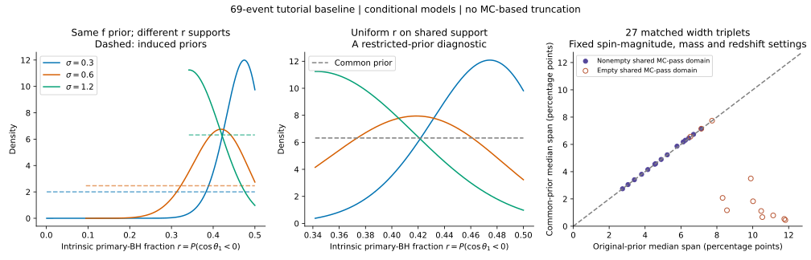

# 阶段一：自旋倾角推断的先验支持与数值精度诊断

完成日期：2026-10-24。定位：公开数据教学基线上的可复现方法研究；不是形成渠道占比测量，也未完成某篇论文的端到端复现。

后续进展：[阶段二](../population-stage2/README.md)已恢复注入侧逐行来源、有限文件选择规则和密度转换，并用成对重采样细化点态MC筛查的解释。以下保留阶段一当时的实验与判断；事件PE来源和完整选择一致性仍未完成。

**阶段结论：当前结果不足以支持稳健的形成渠道解释。** 在相同物理量、相同先验范围的控制实验中，模型差异仍可保留；看似显著缩小的差异又全部出现在低自旋幅度、数值精度未达门槛的组别。此次成果是把“模型假设改变结果”落实为可定位、可复算的诊断，并明确下一阶段应修复的输入与采样问题。

## 1. 数据、模型与研究对象

冻结输入：[results/model.json](../../results/model.json)，SHA-256 为 `6dcf3c9f4fd51b2007977d131c61f69c7d861afb986551ea82b70a7667a51083`。原69事件推断保持不变。本实验使用其事件和注入的重要性权重一、二阶矩，无须重新抽取事件后验。

81个条件设置来自倾角宽度 σ∈{0.3,0.6,1.2}、自旋幅度 Beta∈{(1.5,8.5),(2,5),(1,1)}、质量分布(幂律指数,高斯峰权重)∈{(2,0.1),(3,0.1),(2,0)}及红移演化 λ∈{0,2,4}。模型族仍只有原来的“对齐截断高斯＋各向同性”倾角混合，未覆盖任意分布形式。每个设置的混合权重先验均为 f~Uniform(0,1)；没有对81个设置求模型平均。

主量为主黑洞的内禀群体比例 **r=P(cos θ₁<0)**，即自旋与轨道角动量夹角大于90°。它不是直接观测到的事件比例，不是双星中至少一颗满足条件的比例，更不是动力学形成渠道占比。次要量为 a=P(θ₁<10°)。

若 Bσ 是以+1为中心、在[-1,1]截断的高斯CDF，则 r=1/2+f[Bσ(0)−1/2]。固定σ时，这是f的一一仿射变换。因此posterior/prior的KL、按先验标准差归一的均值位移、后验/先验标准差之比均不变。本次81设置的变换不变性最大误差为2.1×10⁻¹⁵；把坐标范围压小不会创造额外数据约束。

本模型先验就排除了r>0.5。连续先验下f=0/r=0.5是零质量边界，90%等尾区间不含该端点不能自动视为排除各向同性的证据；本轮没有计算这一假说的模型比较。

## 2. 来源审计得到的实质修正

10条FAR空值全部由较新GWTC-2.1参数记录覆盖GWTC-1搜索记录造成。恢复原目录FAR后，十条均符合当前<1/yr条件，69个成员不变。原教程实际保留71项；我们的69项额外排除了GW191204_110529和GW200208_222617。计数恰好为69并不证明等同官方69事件样本。

逐事件原始ID、波形和先验配置、原注入文件及实际检出阈值仍未恢复，事件名称仍依赖摘要匹配。详细证据、版本和哈希见[来源复核](../population-audit/provenance-followup-README.md)。不能把当前管线默认阈值当成历史文件实际阈值。

## 3. 原先验下的条件结果

基线为σ=0.6、自旋Beta(2,5)、质量(2,0.1)、λ=2。

| 量/设置 | 后验中位数 | 90%等尾区间 |
|---|---:|---:|
| f，包含选择校正 | 22.82% | 3.78%–49.15% |
| r，包含选择校正 | 40.75% | 30.08%–48.47% |
| r，故意省略选择校正 | 29.86% | 19.20%–40.88% |
| a，包含选择校正 | 1.048% | 0.807%–1.380% |

选择校正使此基线的r中位数移动10.89个百分点。这是对固定模型故意省略校正的敏感性对照，不能解释成经过校准的选择系统误差。

81设置的r后验中位数覆盖25.32%–49.29%；f中位数覆盖1.43%–81.34%。这是条件模型扫描范围，不是模型平均的可信区间；两个范围宽窄不能直接用来比较信息量。基线原域只有约86.6%后验质量通过沿用的MC筛查（min event ESS≥50、injection ESS≥4N、sd(log L)≤1），全部结果仍保留未通过部分。

## 4. 共同物理先验对照

三个σ诱导的r先验分别在[0.000858,0.5]、[0.094804,0.5]、[0.341740,0.5]上均匀。控制实验改用共同区间[0.341740,0.5]上的均匀r先验，在固定其他参数的27组中比较三个σ。

这是一项**主动限制原参数空间的新先验实验**，只匹配r的边缘先验，不匹配整个倾角分布，也不同时匹配a。全部81设置中，有的原后验仅保留12.70%；不能把裁掉后得到的接近当作稳健性证明。基线保留原先验39.06%、原后验84.97%，r中位数变为41.87%，90%区间35.28%–48.67%。



左图显示基线其他参数固定时的原先验和后验；中图显示共同r先验后的后验；右图每点对应一组σ配对比较，空心点表示共同域内不存在三个设置均通过MC门槛的网格点。图中没有依据MC门槛裁剪后验。

结果可以按自旋幅度假设分解：

| 自旋幅度假设 | 组数 | 统一r先验后的中位数跨度变化 | 共同MC域状况 |
|---|---:|---|---|
| Beta(1.5,8.5)，均值0.15 | 9 | 缩小6.24–11.37个百分点 | 9组全部为空 |
| Beta(2,5)，均值约0.286 | 9 | 增加0.006–0.090个百分点，基本保持 | 3组为空，6组非空 |
| Beta(1,1)，均匀幅度 | 9 | 变化小于0.00002个百分点 | 9组非空 |

各组共同先验下三个后验之间最大的成对总变差距离TV落在0.057–0.651（TV=0表示相同，1表示互不重叠）。这些是数值后验的描述距离，不是排除某模型的概率或显著性。

基线三σ比较时，r中位数跨度从6.700变为6.734个百分点，几乎不变；最大TV为0.558。因而，匹配先验支持并未消除这组模型差异。但只有约54.5%的共同先验域三个模型都通过数值筛查，仍不能宣称差异已超过可靠估计的MC误差。

尤其应注意：**9组差异大幅缩小的结果，全部与数值精度失败重合。** 以质量(2,0.1)、λ=2、Beta(1.5,8.5)为例，σ=0.3时GW190517_055101在共同r网格上始终提供最小事件ESS，约6.47–15.14；σ=0.6/1.2也均不足50。注入ESS约1042–2607虽通过4N门槛，log似然MC标准差约1.44–2.24仍不通过。这定位到事件重加权支持及联合数值误差问题，不能只增加注入数，也不能为了通过门槛删除该事件。

这里“空域”指当前确定的网格及门槛下没有共同通过点；它不是物理模型被排除。点态二阶矩没有提供完整的跨模型、跨超参数MC协方差，未估计“模型差异显著性”。

## 5. 文献对照与本轮贡献边界

[Vitale & Mould (2505.14875v2)](https://arxiv.org/html/2505.14875v2)已研究90°外及10°内的积分比例。本轮沿用其物理量定义，并在本项目受限模型族中检查诱导先验；不是重新提出该指标，也不以固定σ的仿射不变性否定该文自由超参数、多模型和模拟目录研究。

[Wolfe et al. (2609.10753v1)](https://arxiv.org/html/2609.10753v1)已研究有效自旋约束与先验退化。本轮没有复现其有效自旋信息消融，不能把积分量换坐标冒充该实验。其关于MC筛查改变先验的提醒在本实验中落实为同时记录通过筛查的先验和后验质量。

更多近邻研究见[14篇文献对照表](../population-audit/literature-overlap.md)。当前可主张的是本项目的来源修复、可复现诊断及可定位的数值失败案例；尚未证明新颖性，也没有新的天体物理渠道比例。

## 6. 复算与独立验证

仓库根目录执行，依赖NumPy、SciPy、matplotlib；现有适配器环境已具备：

```powershell
.\simulator\.adapters-venv\Scripts\python.exe -X utf8 research/population_functionals.py
.\simulator\.adapters-venv\Scripts\python.exe -X utf8 research/test_population_functional_math.py
.\simulator\.adapters-venv\Scripts\python.exe -X utf8 research/validate_population_functionals.py
```

计算输入只需已跟踪的`results/model.json`；来源复核脚本另需本地原始数据。输出包括[完整JSON](functional-results.json)、[独立验证记录](independent-functional-validation.json)及SVG/PNG图。PNG为本地预览，SVG可版本管理。记录输入、实现脚本和验证脚本的哈希。

4项独立数学测试通过；81设置交叉检查中，4001→8001点的最大分位数变化3.40×10⁻⁷，共同后验与独立积分条件化后验的最大分位差5.30×10⁻⁹。常数似然返回共同均匀先验，误差2.21×10⁻¹⁴。

本轮采用含端点的梯形求积；旧501点累计中点CDF与连续CDF的分位数最多相差0.1003个百分点，旧似然密度与新实现一致至2.45×10⁻¹⁴。因此与旧界面末位差异来自分位约定，未修改原数据或似然。MC通过质量受阶跃边界影响，网格加密后最多变化0.0253个百分点。这些测试验证实现和求积，不验证输入测度、选择一致性或MC偏差。

## 7. 下一阶段的明确入口

1. 从原始发布恢复逐事件PE身份、波形、先验及原注入HDF，并把PE记录和搜索显著性记录分开管理；建立匹配的事件/注入筛选基线。
2. 对低自旋设置的重加权瓶颈补足有效样本，保留事件/注入配对重采样的协方差；区分固定目录MC误差与目录随机性。
3. 在可追溯输入和模拟恢复通过后，复现一个固定版本的文献基线，才扩展自由超参数、多个倾角模型族以及有效自旋信息消融。

只有完成这些步骤，才能将本阶段的“条件诊断”升级为关于实际宇宙群体的稳健结论。
