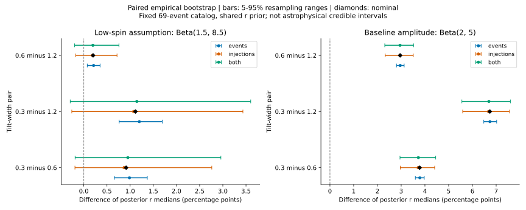

# 阶段二：模型差异能否经受有限样本扰动？

日期：2026-10-24。接续[阶段一](../population-stage1/README.md)，本轮恢复了全部41972条注入的官方来源、运行标签及可复现选择规则，完成六个固定设置、两种独立随机种子、共2048次成对经验重采样，并独立验证协方差及后验计算。输入仍为69事件教学基线。

**主要成果：区分出了在本经验扰动下保持的模型差异，以及会被扰动改变排序的模型差异。** 在基线自旋幅度假设下，σ=0.3与1.2的r后验中位数之差为6.734个百分点，经验重采样的5%–95%范围为5.557–7.600个百分点；在低自旋假设下，对应差仅1.115个百分点，经验范围为−0.293–3.601个百分点。

这些范围描述有限已存样本的扰动，不是天体物理可信区间，也不是显著性或模型正确概率。我们仍未测量形成渠道占比。

## 1. 与阶段一相比，新增了什么

阶段一只使用一、二阶矩做点态精度筛查。阶段二从原始事件/注入数组重建六模型的权重，并让同一次重采样在所有模型、所有参数点之间共享计数。这样保留了误差的相关性，可以直接估计模型中位数差的扰动，避免把两边的误差误当独立。

冻结设置为σ={0.3,0.6,1.2}，自旋幅度Beta={(1.5,8.5),(2,5)}，质量分布(幂律指数,峰权重)=(2,0.1)，红移演化λ=2。低自旋组来自阶段一发现的压力案例，不能当成事先未知结果的盲检验。

主量仍为r=P(cos θ₁<0)，主黑洞自旋与轨道角动量夹角大于90°的内禀群体比例。所有六设置使用[0.341739786994,0.5]上的共同均匀r先验。它限制了原先验支持，不代表一般的天体物理先验。没有对模型求平均，没有根据MC门槛删点。

## 2. 实验与验证

每个事件保留原成员身份，在各自已存后验样本内重采样；注入在一个包含已存权重与未保留零权重的经验分布中重采样。三种模式分别改变事件积分、选择积分、二者。固定种子20261024/20261025各1024次，r网格1001点。完整设计及假设见[执行前设计](design.md)、[独立方法审查](mc-method-review.md)。

关键验证结果：

| 检查 | 结果 |
|---|---:|
| 六模型全部raw权重矩与原结果 | 最大相对误差0 |
| 同一批重采样1001→2001网格，64个固定复算样本 | 最大分位差1.78×10⁻⁷ |
| 显式零权重与折叠零桶的精确协方差 | 误差4.9×10⁻¹⁷ |
| 全网格配对协方差与后验形状指标 | 误差3.6×10⁻¹⁷ |
| 共享计数、正比模型的随机误差抵消 | 误差3.1×10⁻¹⁵ |
| 独立小规模合成重采样 | 20000次，验证通过 |

两个种子的标准差分别记录在JSON中。它们不是两个独立天体物理数据集。2048次只能支持本轮中心范围与SD诊断，不能估计极小尾概率。

另验证了一个容易误用的“修复”：把每条样本复制7次并误当独立，会让估计方差假降为1/7；若正确保留复制样本的完全相关性，方差保持不变。因此本轮bootstrap增加的是诊断次数，**没有增加原始有效样本数**。

## 3. 成对模型差异

下表单位均为百分点，差值定义为较窄σ模型的r后验中位数减去较宽σ模型的中位数。经验范围使用事件和注入同时扰动的结果。

| 幅度假设 | σ比较 | 原差值 | 成对扰动SD | 5%–95%经验范围 |
|---|---|---:|---:|---:|
| Beta(1.5,8.5) | 0.3−0.6 | 0.914 | 0.983 | −0.188–2.958 |
| Beta(1.5,8.5) | 0.3−1.2 | 1.115 | 1.212 | −0.293–3.601 |
| Beta(1.5,8.5) | 0.6−1.2 | 0.201 | 0.299 | −0.198–0.758 |
| Beta(2,5) | 0.3−0.6 | 3.778 | 0.450 | 2.950–4.453 |
| Beta(2,5) | 0.3−1.2 | 6.734 | 0.616 | 5.557–7.600 |
| Beta(2,5) | 0.6−1.2 | 2.956 | 0.370 | 2.309–3.521 |



基线幅度假设下的宽度模型差异在本经验扰动中保持；低自旋设定的经验范围跨零，当前输入不足以稳健确定这三个设置的排序。跨零不证明两个模型相同，不跨零也不证明任一模型正确。

协方差会实质改变误差评估。例如基线σ=0.3与0.6的中位数扰动相关系数约0.812；正确成对SD为0.450个百分点，忽略协方差则得到1.035个百分点。因此不能把各模型误差条直接平方相加。

## 4. 哪种数值扰动影响后验形状更多

单个模型r中位数的经验扰动SD如下，单位百分点：

| 幅度假设 | σ | 只改变事件样本 | 只改变注入 | 同时改变 |
|---|---:|---:|---:|---:|
| Beta(1.5,8.5) | 0.3 | 0.323 | 1.324 | 1.413 |
| Beta(1.5,8.5) | 0.6 | 0.153 | 0.582 | 0.616 |
| Beta(1.5,8.5) | 1.2 | 0.133 | 0.442 | 0.469 |
| Beta(2,5) | 0.3 | 0.188 | 0.730 | 0.753 |
| Beta(2,5) | 0.6 | 0.165 | 0.689 | 0.710 |
| Beta(2,5) | 1.2 | 0.107 | 0.434 | 0.452 |

在这六个固定设置和经验机制下，注入扰动对r中位数的影响大于事件样本扰动。这里没有模拟真实采样遗漏的尾部，也未把后验链相关性和真实注入设计作为已知条件；不能据此停止追溯低ESS事件。

为理解阶段一的点态筛查，我们还计算了

`D=E_{r,r'~p}[Var(delta logL(r)−delta logL(r'))]`。

它保留不同r点间的协方差，并去除对整条logL曲线共同平移的随机部分；共同平移会被后验归一化消去。平均使用固定的原条件后验p(r)，没有对每次结果重新选择支持域。

低自旋σ=0.3设置中，delta-method给出的后验平均点态logL方差为3.730，而配对差方差D约0.254；非线性经验重采样得到D约0.257。该设置的事件部分点态方差0.391，对应形状指标约0.014。这解释了为什么一个事件ESS很低、点态门槛不通过，并不自动等于条件后验形状完全失稳。

**这细化了阶段一的结论，而没有消除其限制：**点态门槛用于发现风险，失败不是物理模型被排除；形状指标较小也不保证没有遗漏尾部、模型偏差或真实选择误差。本轮没有用D<1作为自动“合格证”，也未声称通过实际覆盖率检验。

## 5. 注入来源追溯

这部分从“来源未知”推进到了逐行可核验。官方发布的`o1+o2+o3_bbhpop_real+semianalytic-LIGO-T2100377-v2.hdf5`完整下载后通过官方MD5校验（63,149,928字节，`c21337a25b7318fdfd471cce549a547e`）。[2021发布](https://zenodo.org/records/5636816)和[2023发布](https://zenodo.org/records/7890398)列出的该文件MD5一致。

- 本地全部41972条注入在原文件中唯一匹配；质量、质量比、红移、两个自旋幅度及两个倾角余弦，七列逐元素完全相等，原顺序保持。
- 可精确复现保留规则：五个搜索管线任一IFAR>1 yr，或O1/O2运行的optimal network SNR>10。与本地行集合的对称差为0。这里证明的是该有限文件上的规则重建，不证明唯一恢复了历史命令或软件版本。
- 恢复运行标签：O1保留1623条、O2保留3881条、O3保留36468条；保留原始行号映射供后续设计感知的分析使用。
- 本地prior精确等于`sampling_pdf * mass1_source * (2π a1²) * (2π a2²)`，恢复了注入侧的坐标测度转换。

原文件的`total_generated`为非整数73280198.73534885；本地管线记录是其整数部分73280198。元数据含有效混合归一化，不能未经审计就将本地整数当作已验证的物理独立试验次数。观测时长63129577秒换算后与本地2.000455579638502年完全一致。

来源恢复还发现，本地prior没有吸收官方`mixture_weight`。三个运行的权重分别约为1.000005724、0.999998219、0.999999205，应在对应重要性求和项中另乘。我们增加了一个单独记录的[确定性控制](mixture-weight-control.json)：保持事件与模型不变，仅乘回这些权重。六模型共同先验下r中位数最大变化6.65×10⁻⁹，即约0.000000665个百分点；原先验下最大变化3.65×10⁻⁸。4001/8001网格对修正量的差小于1.88×10⁻¹¹。

另有适用于任意非负模型权重的上界：69事件条件logL形状改变量不超过`69 log(wmax/wmin)=5.18×10⁻⁴`。把总量从整数恢复为非整数仅增加参数无关常数，归一化后验的数值总变差为1.52×10⁻¹⁴。**因此，此处已恢复的近1混合权重遗漏和总量截断，不能解释本轮百分点量级的模型差异。** 这一结论只排除了这两项具体因素，不代表所有选择误差都可忽略。

本轮多项式模拟精确对应的是**明确假设的经验权重扰动机制**。它不是原始campaign重复运行的抽样分布。恢复保留行和先验密度后，运行间混合、子群混合、各层原始生成数及样本相关性仍需分别审计；事件PE侧的波形、先验配置和事件选择一致性也未完成。完整证据见[来源报告](provenance-README.md)和[逐行核查JSON](provenance-injection-match.json)。

## 6. 文献位置与阶段边界

[Talbot & Golomb (2304.06138v2)](https://arxiv.org/html/2304.06138v2)已研究MC误差及选择积分对群体推断的影响；[Essick & Farr (2204.00461v1)](https://arxiv.org/abs/2204.00461v1)已强调复用样本导致的相关误差。本轮是针对本项目输入的实现、验证和定量诊断，不主张新的协方差方法。

本轮可以说：共同先验并不自动消除模型差异；在明示经验扰动机制下，基线幅度假设的模型差异保持，而低自旋组的细小差异不稳定。不能说：已得到模型无关倾角比例、确认某个形成渠道占主导、或者真实注入及PE系统误差已控制。

下一阶段应优先使用已恢复的原始注入字段，冻结可审计的事件与选择规则，建立与真实注入混合设计相符的数值误差模型；随后在合成目录上检验恢复与覆盖率，再决定是否扩展自由超参数及模型族。

## 7. 复算文件

主脚本使用仓库根目录`requirements.txt`中的NumPy/SciPy/Astropy。另需matplotlib绘图；本次使用Python3.14、NumPy2.4.6、SciPy1.18.0、Astropy8.0.1、matplotlib3.11.0。

```powershell
python -X utf8 research/population_mc_bootstrap.py
python -X utf8 research/validate_population_mc_synthetic.py
python -X utf8 research/validate_population_mc_implementation.py
python -X utf8 research/population_mixture_weight_control.py
```

主脚本读取`data/posteriors.npz`、`data/injections.npz`及冻结的`results/model.json`，重算每次核验的raw weights。本地原始数据不随源码分发。结果JSON记录全部输入和实现哈希、随机种子、每次分位数、分模式SD和协方差；`bootstrap-means.npz`为本地复查缓存。

- [完整经验结果](paired-bootstrap-results.json)
- [合成机制验证](independent-synthetic-validation.json)
- [主实现独立验证](independent-implementation-validation.json)
- [标准科学图SVG](paired-mc-comparison.svg)
- [原始注入逐行来源核验](provenance-injection-match.json)
- [恢复混合权重后的定量控制](mixture-weight-control.json)

阶段一及原始81设置结果保持不变，当前科学成果以此报告明示的条件为边界。
