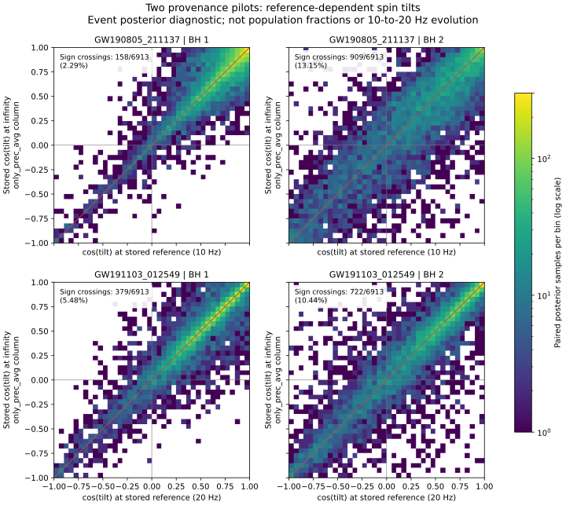

# 阶段三试点：名单相同，后验分析与自旋参考定义仍需统一

完成日期：2026-10-25（北京时间）。这是接续阶段二的数据来源研究与配对诊断，不是新的群体推断。已发布的模型、事件数组、注入数组、论文和 PDF 均未改动。

后续进展：[阶段四](../population-stage4/README.md)已恢复全部教学数组的数值先验公式，并完成两事件替换及遗漏高权重样本诊断。下文保留本阶段完成时的结论和范围。

本轮完成两项核验：当前69个候选事件身份与LVK群体论文的BBH名单一致；两个事件共13,826条本地后验样本，在官方发布的 **C01:IMRPhenomXPHM** 标签下七列完全一致。两份分析配置分别记录10 Hz与20 Hz参考频率。因而，“名单一致”不能升级为“复现了LVK的后验选择”，也不能把旧条件结果直接解释为统一参考频率下的群体倾角分布。

## 1. 事件成员核验

从 [LVK GWTC-3 群体论文 v3 的 Table 1](https://arxiv.org/html/2111.03634v3#S2.T1) 自动提取76个表格行事件名。依据其III、V、VI节，去掉7个包含或可能包含低质量伴星、未纳入默认BBH分析的事件：GW170817、GW190425、GW190426_152155、GW190814、GW190917_114630、GW200105_162426、GW200115_042309。剩下69项，与本地名单完全一致：遗漏0、额外0。

GW190412与GW190521使用明确的短名/全名映射，不能用截断日期的方法模糊合并。解析器只读取表格单元格；表注提及但没有后验参数的GW190531不计为表格事件。

这解决了**候选身份名单**的比较。其余67个事件仍只有先前的摘要身份匹配，不能因名单相符就宣称全部PE数据逐行核验完成。机器可读结果：[event-membership.json](event-membership.json)。

## 2. 两个样本级来源试点

试点按下载体积与跨发布覆盖选择：分别取GWTC-2.1与GWTC-3中较小、且本地已包含的cosmo文件。不是随机抽取的代表性样本，不能据此估计全目录存在某问题的比例。

| 本地原索引 / 事件 | 官方发布 | 本地样本数 | IMRPhenomXPHM七列精确匹配 | Mixed七列匹配 | SEOBNRv4PHM匹配 | 配置参考频率 |
|---|---|---:|---:|---:|---:|---:|
| 38 / GW190805_211137 | [6513631 v2](https://zenodo.org/records/6513631) | 6913 | 6913 | 171 | 0 | 10 Hz |
| 48 / GW191103_012549 | [5546663 v1](https://zenodo.org/records/5546663) | 6913 | 6913 | 1242 | 0 | 20 Hz |

七列为源参考系主质量、质量比、红移、两个自旋幅度、两个倾角余弦。先按`(mass_1_source, redshift)`唯一连接，再逐列检查完全相等；另外用`(a_1, redshift)`连接，恢复的原始行号也完全相同。两事件各6913条对应行均不重复。独立验证使用七维完整行的集合交集，不调用上述连接算法；错置事件和篡改倾角的反例均返回0匹配。

文件名中的`mixed_cosmo`不等于读取了文件内部的`C01:Mixed`。这里确证的是本地样本包含于单波形标签中，而非恢复了历史预处理命令。参考频率同时由`meta_data/meta_data/f_ref`及配置`reference-frequency`核对。两个源分析均记录`Planck15_lal`宇宙学。全部标签、配置摘录、来源哈希见 [pe-pilot-match.json](pe-pilot-match.json)；官方MD5及SHA256见 [pilot-downloads.json](pilot-downloads.json)。两文件共64,794,885字节。

文件中保存的原始解析距离先验字符串为`PowerLaw(alpha=2, ...)`，但[发布说明](https://zenodo.org/records/6513631)明确cosmo版本已经重加权到源参考系共动体积中的均匀并合率先验。因此不能直接拿解析配置字符串充当最终后验的距离先验。本轮保存这些字符串作为证据，没有执行它们，也没有宣称恢复了教学数组的数值`prior`。质量先验支持、0.99自旋幅度上限、宇宙学转换与归一化仍需完整审计。

## 3. 同一批样本的倾角参考诊断

对已找到的原始行，读取源文件提供的`cos_tilt_*_infinity_only_prec_avg`列，与本地保存的参考频率倾角逐行配对。没有自行演化自旋，也没有把该列默认为精确的完整动力学演化结果。源文件的后向演化元数据随JSON保留；算法与版本精度需要后续专门检查。

| 事件 / 分量 | 参考频率下cos倾角<0的后验样本比例 | 文件所给无穷远列的比例 | 穿过cos倾角=0的配对样本 |
|---|---:|---:|---:|
| GW190805 / 主黑洞 | 6.365% | 5.902% | 158/6913（2.286%） |
| GW190805 / 次黑洞 | 28.164% | 29.481% | 909/6913（13.149%） |
| GW191103 / 主黑洞 | 11.457% | 11.876% | 379/6913（5.482%） |
| GW191103 / 次黑洞 | 25.734% | 26.371% | 722/6913（10.444%） |

穿越可以双向发生，所以穿越比例与负余弦比例的净变化不同。这些数字只描述**两个事件在各自PE先验下的已存后验样本**，不是阶段一、二的内禀群体量r，不是形成渠道占比，也不是10→20 Hz变化量。尚未对注入样本做同样的变量变换，不能只替换事件倾角后重新声称得到校正的群体结果。



图中每个像素累计相同原始行的两个倾角，红线表示二者相同。四幅图使用相同的对数颜色刻度。样本全部有限；完整统计在JSON内。绘图PNG仅供本机预览，SVG随源代码保存。

## 4. 与文献的关系与对旧结果的影响

[Mould & Gerosa, Gravitational-wave population inference at past time infinity, 2110.05507v2 / PRD 105, 024076](https://arxiv.org/abs/2110.05507v2) 已讨论统一自旋参考定义与选择效应的关系。本轮查阅其摘要与研究定位，未复现其方法；不会把“参考频率影响倾角”称为新发现。即使统一为探测器参考系20 Hz，不同质量和红移的事件也未必处于相同无量纲动力学阶段，不能把20 Hz当作无需论证的通用物理定义。

[LVK群体论文III.1节](https://arxiv.org/html/2111.03634v3#S3.SS1)说明其输入后验采用距离平方先验，并说明O3b采用C01:Mixed等具体选择。我们两个试点对应cosmo文件中的单波形标签，因此当前教学基线并不等于该论文的PE实现。这不自动证明教学先验校正错误；改变后验先验而正确除去对应密度，原则上可以得到相容的层次似然。需要检验的是数值`prior`、支持域及实际输入是否配套。

旧版6.734个百分点等模型差异仍是原数组与固定权重计算下可复现的结果；本轮没有重新计算或推翻这些数值。不过其物理解释必须保留更具体的限制：**当前输入至少存在不同自旋参考频率，全部波形与先验对应关系尚未恢复。** 不能仅凭原经验重采样范围较窄，就据此给出统一物理参考下的倾角比例或形成渠道结论。

## 5. 复现与下一实验

依赖：Python、requests、NumPy、h5py、matplotlib。运行位置为仓库根目录；本机使用`simulator/.adapters-venv/Scripts/python.exe`。原始教学NPZ恢复办法见 [复现总指南](../REPRODUCING_POPULATION.md)。

```text
python research/population-stage3/collect_sources.py
python research/population-stage3/download_pilot.py
python research/population-stage3/audit_membership.py
python research/population-stage3/match_pe_pilots.py
python research/population-stage3/validate_pilots.py
python research/population-stage3/plot_pilots.py
```

前两步访问公开网络，其余离线。数据与论文HTML仅存在本地忽略目录；公开文件为脚本、摘要、来源清单与图。脚本下载固定历史版本，不自动跳到较新发布。校验结果见 [validation.json](validation.json)。

下一实验以这两个已验证事件为控制集，先恢复最终PE先验的测度、支持与宇宙学转换，再比较单波形与混合后验的层次积分。扩展到其余67个事件时记录每个分析的参考频率；选定统一自旋参考协议后，事件和注入必须一同转换，并核对原始注入自旋的参考定义及密度变换。完成这些以后，才把“波形/参考定义变化”加入现有成对模型比较。当前阶段不以增加网页功能或直接扩大目录替代这些步骤。
