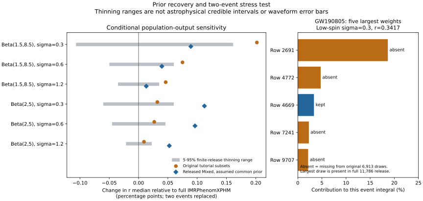

# 阶段四：恢复全部先验数值，找到子集遗漏的高权重样本

日期：2026-10-25。接续[阶段三](../population-stage3/README.md)，本轮完成73事件先验公式恢复、两个事件的完整PE样本替换、512次有限发布文件的无放回删薄，以及独立数值验证。原论文、PDF、`results/model.json`和原始事件/注入数组保持冻结。

后续：[阶段五](../population-stage5/README.md)已将GW190805的cosmo样本逐行映射回169040条原始先验样本，并验证了保留连续权重的计算路径。下文保留本阶段的原结果与条件。

**阶段成果：**504,649条已存先验值被同一历史公式复现到浮点舍入精度；两事件替换在六模型中的最大r中位数变化约0.202个百分点；更重要的是，在低自旋σ=0.3设置下发现GW190805原子集遗漏了一条高权重样本。在原后验中位数处，该样本占完整发布文件事件积分的15.865%。这把“已有子集重采样不能覆盖遗漏样本”的限制落实到了真实输入上。

本轮属于来源恢复与条件压力测试。两事件不足以代表整个目录，Mixed的最终PE先验支持尚未完全恢复，尚未形成新的天体物理占比结论。

## 1. 先验公式终于可逐样本复现

定位到[gwpopulation_pipe固定提交5dbcb49（2024-04-15）](https://git.ligo.org/RatesAndPopulations/gwpopulation_pipe/-/blob/5dbcb49d602393f23d91e4d2b9a4cbae52d843a8/gwpopulation_pipe/data_collection.py)的`evaluate_prior`。独立实现其公式，未导入执行下载的代码。结果为：

\[
\pi_{\rm stored}(m_1,q,z,a_1,a_2,c_1,c_2)
= \widetilde p_z(z)\,(1+z)^2\,m_1/4,
\qquad c_i=\cos\theta_i.
\]

这里的密度测度为`dm1_source dq dz da1 da2 dc1 dc2`。两个质量由探测器参考系分量质量转到源参考系主质量和质量比，Jacobian为`m1*(1+z)^2`；两个均匀倾角余弦的密度因子为1/4。该表达式描述本地存储的数值，不自动包含每个原始PE分析的全部硬支持边界和归一化。

红移项由Astropy **Planck15** 计算：

\[
p_z(z)\propto \frac{4\pi}{1+z}\frac{dV_c}{dz},
\]

在1000点等距网格上先归一化再线性插值。恢复的网格为`[0,2.4317563684567265]`，上限恰好是全部73事件最大已存红移`2.4076795727294322`的1.01倍。它能复现本地值，但不能唯一恢复原命令的`max_redshift`参数或证明历史上恰好运行了这一提交。

| 检查 | 结果 |
|---|---:|
| 已检查事件数组 | 73 |
| 已检查样本 | 504,649 |
| 最大相对残差 | 5.55×10⁻¹⁶ |
| 对应红移归一化积分 | 3.54808902217×10¹¹ Mpc³ |
| 取消质量Jacobian、取消红移质量Jacobian、改为欧氏距离先验 | 73事件全部无法复现形状 |

反例在允许一个自由比例常数后仍有残差，避免把“只差归一化”误判成形状错误。恢复结果在 [prior-recovery.json](prior-recovery.json)，代码在 [recover_prior.py](recover_prior.py)。

最大红移来自随后被FAR筛选排除的原索引64。它仍可影响预处理网格和归一化。每事件与超参数无关的整体常数会从条件后验形状中消去；本轮以任意每事件缩放验证了这一点。插值网格位置则可能造成很小的形状差异，另有直接密度对照。

**已解决的是教学数组`prior`的计算来源，不是所有原始PE先验的物理验证。** 本地数字不再是无法解释的黑箱；其是否与每个事件实际采样测度、支持域完全一致，仍需原文件配置与发布说明共同确认。

## 2. 两事件替换实验

沿用阶段二六个固定设置：σ={0.3,0.6,1.2}，幅度Beta={(1.5,8.5),(2,5)}，质量(α,峰权重)=(2,0.1)，红移λ=2，共同均匀r先验`[0.341739786994,0.5]`。其余67事件、全部注入和选择积分保持不变。

每个试点比较原6913条子集与官方完整IMRPhenomXPHM、官方完整Mixed。原始源文件及校验信息沿用阶段三。完整IMR样本数分别为11786、9914；Mixed分别为6196、9859。所有标签统一使用恢复的教学先验函数评价，不重新调整模型。原倾角列和10/20 Hz配置保持原状，未替换为无穷远倾角。

下表为**同时替换两个事件**后，r后验中位数相对原教学基线的变化，单位为百分点。

| 自旋幅度假设 | σ | 完整IMRPhenomXPHM | 完整Mixed（共同先验假设） |
|---|---:|---:|---:|
| Beta(1.5,8.5) | 0.3 | −0.20191 | −0.11271 |
| Beta(1.5,8.5) | 0.6 | −0.07495 | −0.03523 |
| Beta(1.5,8.5) | 1.2 | −0.04627 | −0.03312 |
| Beta(2,5) | 0.3 | −0.03203 | +0.08032 |
| Beta(2,5) | 0.6 | −0.02676 | +0.06953 |
| Beta(2,5) | 1.2 | −0.00924 | +0.04322 |

分别只替换一个事件的结果也保存在 [sensitivity-results.json](sensitivity-results.json)。不能将替换Mixed后的变化全归于波形误差：它还包含混合构造、有限样本及尚未核清的分析差异。

σ=0.3与1.2的中位数差如下，仍以百分点计：

| 幅度假设 | 原基线 | 两事件完整IMR | 两事件Mixed |
|---|---:|---:|---:|
| Beta(1.5,8.5) | 1.11489 | 0.95925 | 1.03530 |
| Beta(2,5) | 6.73380 | 6.71101 | 6.77091 |

在这项局部测试中，基线幅度假设下的大模型差异保持。这不是全目录稳健性的结论；67事件、选择效应和共同参考定义尚未在本轮更换。

## 3. 增加样本暴露了遗漏尾部

在GW190805、Beta(1.5,8.5)、σ=0.3的设置中，完整发布文件出现原子集没有的高权重样本。原始行号2691是已校验官方HDF内部IMRPhenomXPHM数组的零基索引。

| 评价位置 | 原6913条的权重ESS | 完整11786条的权重ESS | 该遗漏样本占完整事件积分 |
|---|---:|---:|---:|
| 共同支持下边界r=0.341740 | 58.38 | 23.11 | 18.664% |
| 原条件后验中位数r=0.382554 | 64.61 | 30.15 | 15.865% |

这里ESS=`(sum w)^2/sum(w^2)`，衡量重要性权重集中程度，不含PE链相关性。样本数增大而ESS减小，是因为新增样本中出现了显著较大的权重。不能据此丢弃这个样本以提高ESS；也不能说原子集的较高ESS证明更准确。

在下边界点，完整样本中最大的五个权重有四个不在原子集中。原子集内的bootstrap无论重复多少次，都不能生成这些缺失行。这是对阶段二经验重采样范围的一个具体限制：阶段二量化的是给定已存数组的扰动，无法保证遗漏区域已经得到正确覆盖。本轮没有估计未发布尾部，也没有由一条高权重样本推出新的黑洞物理性质。

## 4. 无放回删薄与附加先验对照

从两份完整IMR发布样本中各无放回抽取6913条，重复512次；每次六模型使用同一子集，两个事件独立抽取，种子20261025。比较对象为对应的完整IMR结果。它衡量**给定有限文件的随机删薄影响**，不模拟整条PE链、真实数据再观测或Mixed分析误差。

低自旋σ=0.3的中位数差5%–95%经验范围为`[−0.10679,+0.16147]`个百分点，SD=0.09260个百分点；实际原子集相对完整IMR的差为`+0.20191`个百分点。不能把落在经验中心范围之外转换成异常显著性：原预处理抽样机制尚未恢复，试点也不是盲选样本。



左图以完整IMR结果为零点，故与上表以原基线为零点的符号不同。灰色条只有有限文件删薄含义；蓝色Mixed点没有被赋予已校准误差条。右图显示同一事件在明确r位置的积分贡献，不是事件存在概率或群体占比。

另对原两个事件的先验分母做形状对照：

| 先验分母对照 | 六模型中最大绝对r中位数变化（百分点） |
|---|---:|
| 恢复的线性插值→直接Planck15密度 | 0.000001113 |
| 恢复的密度→直接Planck15_lal密度 | 0.000110161 |

前者在这里远小于样本替换效应。后者依照[PESummary公开定义](https://git.ligo.org/lscsoft/pesummary/-/blob/master/pesummary/gw/cosmology.py)采用ΛCDM的H0=67.90、Ωm=0.3065、ΩΛ=0.6935；代码用等价的平直ΛCDM构造。Astropy Planck15则使用[另一组参数](https://docs.astropy.org/en/stable/api/astropy.cosmology.realizations.Planck15.html)。本轮固定现有质量、红移坐标和群体模型，只改变两个分母，不能称为完整宇宙学一致性修复。公开定义的下载快照及SHA256已记录，未据当前文件断言历史软件版本。

## 5. 为什么Mixed还只是压力测试

GW191103的SEOBNRv4PHM/RIFT配置中`chirpmass-max=10`，但发布样本的探测器参考系啁啾质量最大约10.3805。其解析先验组为空。仅凭配置这一项无法确定最终硬支持，也不能把超过10的样本当作无效数据删掉；配置可能属于分析的部分阶段，尚需追溯其实际含义。

因此，本轮没有宣称完整恢复Mixed的所有先验、校准与混合规则。统一套用教学先验是在测试当前分析程序对输入标签的敏感性，而非证明不同标签的真实层次似然已经完全同测度。详细元数据见 [pilot-bank-metadata.json](pilot-bank-metadata.json)。

同样，原PE自旋幅度上限0.99与群体模型支持到1的关系、事件专属质量与距离支持，以及10/20 Hz的自旋参考定义，均需保持在下一轮的核验清单中。单靠恢复样本处的密度公式不能解决这些支持问题。

## 6. 验证、复现与课题定位

[独立验证](validation.json)直接重建完整69事件似然乘积，不复用替换对数差算法，分位数最大差8.33×10⁻¹⁶。1001→2001点网格复算最大分位数差1.52×10⁻⁷。质量Jacobian的独立行列式检查、任意每事件常数缩放不变性、73事件反例及冻结输入哈希检查均通过。这些是数值与实现检查，不是对Mixed共同先验假设的物理认证。

[实验设计](design.md)在替换计算前写入，明确说明先验公式已在探索阶段恢复；没有伪装为事前未知结果的预注册。

在仓库根目录运行，依赖requests、NumPy、SciPy、Astropy、h5py、matplotlib：

```text
python research/population-stage4/fetch_sources.py
python research/population-stage4/recover_prior.py
python research/population-stage4/extract_pilots.py
python research/population-stage4/run_sensitivity.py
python research/population-stage4/validate_stage4.py
python research/population-stage4/plot_stage4.py
```

本机`extract_pilots.py`使用`simulator/.adapters-venv/Scripts/python.exe`以读取HDF，其余计算使用含Astropy的Python。需先按阶段三恢复官方试点文件并生成行映射、按[总复现指南](../REPRODUCING_POPULATION.md)恢复教学数组。仅第一步联网；源码快照、HDF与中间NPZ不随仓库发布，保留来源URL与校验值。阶段三输入与先验恢复结果也被脚本验证。

来源恢复、重要性重加权、ESS与有限样本诊断均是已有方法。其文献背景沿用[Talbot & Golomb, Growing Pains](https://arxiv.org/abs/2304.06138)及[现有对照表](../population-audit/literature-overlap.md)，不主张“有限样本会影响群体推断”为新发现。这里的增量是可复现地定位当前教学数据的公式与实际遗漏样本，并量化它们在同一比较量上的影响。

下一阶段优先做两件事：恢复更多完整事件样本并检查重加权尾部；追溯RIFT最终先验与支持，再决定能否把Mixed比较升级为正式PE模型对照。随后统一事件与注入的自旋参考协议。现有阶段二结果保留为条件诊断，新增的尾部证据应进入下一版论文的限制与数据说明，而不是静默覆盖旧版结果。
