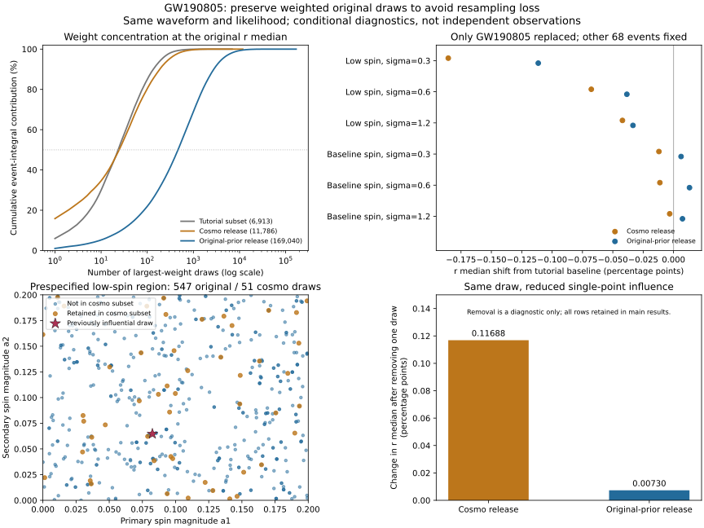

# 阶段五：恢复原始先验样本，降低单点支配

2026-10-25。阶段四发现的GW190805高权重样本，是本轮定向追查对象。本轮核验了同一官方版本中cosmo与nocosmo文件的关系，完成正确先验除法下的表示比较，并验证保留连续权重、避免再次抽样的计算路径。

**主要成果：**同一IMRPhenomXPHM分析的原始先验文件包含169,040条样本；全部11,786条cosmo样本都能逐行回溯。固定在原低自旋σ=0.3条件后验中位数处，使用各自匹配的先验计算时，权重ESS由cosmo文件的30.17提高到原始文件的998.36；之前那条样本的积分贡献由15.86%降到1.04%。同一批原始样本若保留重加权系数，转换先验前后的积分一致到2.22×10⁻¹⁶相对误差，无须再抽成较小的等权样本。

这些是同一次PE分析的数值表示与尾部诊断。没有新增观测事件，尚不能据此声称整个目录已经收敛或测得新的形成渠道比例。已发布论文和全部冻结输入保持不变。

## 1. 同一分析、两种有限表示

新增下载文件来自固定[Zenodo 6513631 v2](https://zenodo.org/records/6513631)：`IGWN-GWTC2p1-v2-GW190805_211137_PEDataRelease_mixed_nocosmo.h5`，335,235,368字节。通过官方MD5 `48f54be02ce96a88289f9b993f6f169b`，SHA256及URL在 [download.json](download.json)。这里只使用内部`C01:IMRPhenomXPHM`标签。

核验结果：

- nocosmo有169040条，cosmo有11786条。后者全部在前者中唯一匹配；没有重复的主质量/红移连接键。
- 七个物理坐标逐元素相等；另核对了光度距离、探测器参考系质量、啁啾质量及`log_likelihood`，同样完全一致。
- 完整配置内容、解析先验字符串一致。波形为IMRPhenomXPHM，参考频率10 Hz，宇宙学标签Planck15_lal。
- 原cosmo行2691对应nocosmo行37941，行号均为零基索引。

结果见 [representation-match.json](representation-match.json)。这不是两套独立观测，也不是一个不同波形的再次拟合。官方cosmo文件是另一先验下的有限重加权表示，包含的行集合比原始表示小；这里恢复了集合关系，没有恢复产生该子集的历史随机种子或完整重采样命令。

## 2. 换先验必须同时更换分母

令θ为`(m1_source,q,z,a1,a2,cos tilt1,cos tilt2)`。两种先验在相同支持内、略去与群体超参数无关的常数后为

\[
\pi_c(\theta)\propto {dV_c/dz\over 1+z}\,{m_1(1+z)^2\over4},
\qquad
\pi_n(\theta)\propto D_L^2{dD_L\over dz}\,{m_1(1+z)^2\over4}.
\]

前者是源参考系共动体积中的均匀并合率先验，后者来自原始`D_L²`距离先验。均使用Planck15_lal，保持已有源参考系坐标和群体模型。其光度距离计算与发布值的最大相对差为2.56×10⁻⁸；没有重新生成质量或红移。

从原始后验`q_n ∝ L π_n`转换到`q_c ∝ L π_c`时，逐样本权重为`w=π_c/π_n`。因此

\[
\frac{\sum_i w_i\,p(\theta_i|\Lambda)/\pi_c(\theta_i)}{\sum_i w_i}
=\frac{\sum_i p(\theta_i|\Lambda)/\pi_n(\theta_i)}{\sum_i w_i}.
\]

右侧相对原始后验直接积分只差一个不依赖Λ的整体常数，它从本研究的条件后验形状中消去。本轮对全部原始行和六模型验证该关系，最大相对残差2.22×10⁻¹⁶，最终分位数最大差2.22×10⁻¹⁶。

**这一恒等式支持保留原始样本与连续权重的实现，并不证明两份不同大小的有限发布数组已经收敛到完全相同的积分。** 若把nocosmo样本直接交给cosmo分母、却不施加对应权重，就不再是上述换测度。

## 3. 原高权重样本的影响被分散了

以下均在Beta(1.5,8.5)、σ=0.3及原后验中位数`r=0.382553528449`评价，参考频率保持10 Hz。原教学子集一列保留原先验数值；两份官方完整数组采用一致Planck15_lal。

| 指标 | 教学子集 | 完整cosmo | 完整nocosmo，正确先验除法 |
|---|---:|---:|---:|
| 样本行数 | 6913 | 11786 | 169040 |
| 重要性权重ESS | 64.61 | 30.17 | 998.36 |
| 最大单行积分贡献 | 5.97% | 15.86% | 1.04% |
| 累积贡献一半积分所需的最大权重行数 | 24 | 25 | 465 |
| `a1<0.2且a2<0.2`的样本行数 | 32 | 51 | 547 |
| 上述区域对该事件积分的贡献 | 34.39% | 45.36% | 33.09% |

该低自旋区域在新计算前于[设计文件](design.md)中固定，用来描述尾部覆盖，不是筛选事件或删除样本的规则。上表是**事件积分**，不是主黑洞低自旋概率或群体比例。ESS不包含PE链相关性，不能读成998个独立物理观测。

原样本的自旋幅度约`a1=0.08253,a2=0.06473`，处于这一低自旋区域。完整原始文件在该区域有更多行，积分不再由该点单独承担很大比例。它仍是这个设置下最大的一行，不应因为权重大而删掉。

作为影响诊断，暂时去掉同一行时，r中位数变化在cosmo中为`+0.11688`个百分点，在nocosmo中为`+0.00730`个百分点。主要结果始终保留该行；此诊断不作为推荐的异常值处理。

## 4. 对条件群体结果的影响

只替换GW190805，其余68事件、注入样本、选择积分、六模型和共同r先验全部固定。r仍是原条件模型下的倾角积分量，整个目录的共同物理参考定义未在本轮修复。

下表为r中位数相对原教学基线的变化，单位百分点：

| 幅度假设 | σ | 完整cosmo，匹配先验 | 完整nocosmo，匹配先验 |
|---|---:|---:|---:|
| Beta(1.5,8.5) | 0.3 | −0.18549 | −0.11139 |
| Beta(1.5,8.5) | 0.6 | −0.06772 | −0.03844 |
| Beta(1.5,8.5) | 1.2 | −0.04209 | −0.03341 |
| Beta(2,5) | 0.3 | −0.01203 | +0.00619 |
| Beta(2,5) | 0.6 | −0.01125 | +0.01313 |
| Beta(2,5) | 1.2 | −0.00317 | +0.00736 |

两种完整有限表示之间，最大中位数差约0.07410个百分点。本轮未为这个差赋予已校准的显著性，也未证明完全来自某个具体拒绝抽样算法。

基线幅度组中，σ=0.3与1.2的模型中位数差由原6.73380变为6.73263个百分点；低自旋组则由1.11489变为1.03691个百分点。因此此前的大模型差异在这一个事件的表示测试中保持，而较小差异对后验样本选择更敏感。不要把“一个定向试点保持”推广为整个目录稳健。



图的左上及右下使用固定低自旋σ=0.3设置，左下只展示事先固定的低自旋区域；右上展示六模型。所有图点来自已核验文件，不增加或平滑出新后验样本。完整统计见 [tail-results.json](tail-results.json)。

## 5. RIFT先验追溯：形状说明已有，最终支持仍未恢复

本轮进一步查阅两篇原始目录论文的方法部分：

- [GWTC-2.1 v2](https://arxiv.org/pdf/2108.01045v2)，PDF第22页V.C及邻近方法段落：说明自旋幅度、探测器参考系分量质量的先验形状，以及Bilby/LALInference与RIFT处理校准不确定度的不同流程。
- [GWTC-3 v3](https://arxiv.org/pdf/2111.03606v3)，PDF第63页“Priors and sampling algorithms”：说明逐事件选择先验范围，并在需要时扩展质量比支持；最终进行源参考系共动并合率先验的重加权。

这些资料支持共同的基本先验形状，**没有给出当前两个RIFT发布数组完整的最终逐事件数值支持记录**。两份HDF的RIFT解析先验组与先验样本组均为空，版本字段为缺失说明。GW191103中，10306条SEOBNRv4PHM样本有3655条啁啾质量超过配置中的10，上界到10.3805。不能把该配置字段当作最终硬切割，也不能据此认定这些样本有错。

核验结果保存在 [rift-prior-audit.json](rift-prior-audit.json)，论文固定版本、PDF哈希在 [来源清单](sources/manifest.json)。阶段四Mixed比较仍保留为共同先验假设下的压力测试，没有在本轮升级为完整波形系统误差结论。

## 6. 验证、复现与下一轮

[独立验证](validation.json)从完整69事件乘积重算条件后验，分位数最大差9.44×10⁻¹⁶；距离Jacobian的有限差分检查最大相对差1.83×10⁻¹⁰；网格1001→2001点分位数最大变化1.47×10⁻⁷。输入、源文件哈希及排序权重ESS校验通过。这些验证不替代PE采样收敛或天体物理覆盖率检查。

运行位置为仓库根目录。依赖requests、h5py、NumPy、SciPy、Astropy、matplotlib；需先恢复阶段三、四使用的教学NPZ、官方cosmo文件和冻结结果。

```text
python research/population-stage5/download_nocosmo.py
python research/population-stage5/fetch_methods.py
python research/population-stage5/extract_and_match.py
python research/population-stage5/run_tail_study.py
python research/population-stage5/validate_stage5.py
python research/population-stage5/plot_stage5.py
```

本机HDF抽取使用`simulator/.adapters-venv/Scripts/python.exe`，数值计算使用含Astropy的Python。前两步联网，文件固定历史版本并校验，后续离线。原始335 MB文件和中间NPZ仅保存在本机忽略目录；下载分块在完整文件MD5验证成功后清理。源代码、来源摘要、统计与SVG保留用于复现。

本轮的增量是恢复并验证了**同一分析的依赖关系与可避免的后处理样本损失**。重要性重加权及保留权重本身是已有方法，不主张新方法或新黑洞族群。与之前[有限样本文献对照](../population-audit/literature-overlap.md)一致，本轮也没有把更高ESS视为全面准确性的保证。

下一轮可以沿这个已验证路径，建立保留原始PE先验、逐行权重、参考频率及来源的事件接口，扩展高权重尾部检查到更多事件；再统一事件与注入的自旋参考协议。RIFT最终先验与校准来源继续独立追溯。这样能够先控制数值表示带来的变化，再讨论模型或形成机制的差异。
