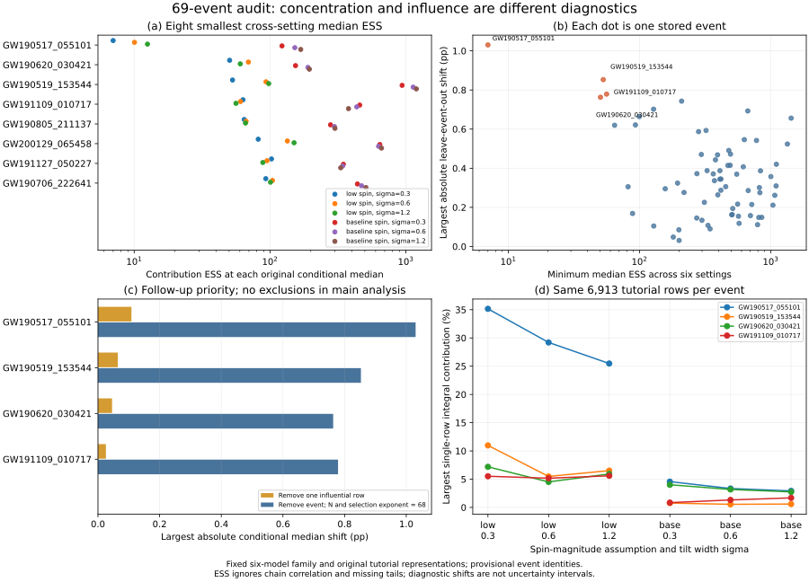

# 阶段六：加权事件接口与69事件检查顺序

2026-10-25。第五阶段把GW190805的完整原始先验样本找回后，本轮将计算整理成可复用接口，并对原69事件、六模型进行414组数值筛查。**本轮完成目录筛查和单事件接口验证；其余候选事件的完整原始样本尚未恢复。** 已发布论文、PDF、工作台及冻结模型不变。

主要发现：暂定对应GW190517_055101的教学数组，在Beta(1.5,8.5)、倾角宽度σ=0.3的原条件中位数处，贡献ESS仅6.998；一个样本承担35.16%的事件积分，最大的三行合计已经超过一半。它因此成为下一次原始数据核验的首要对象。这不是对该观测真实性或其天体物理价值的否定，也不构成删除样本的依据。

## 1. 事件接口保留什么

新模块为 [population_event.py](../population_event.py)。每个对象携带：

- 原始源文件、公开URL、SHA256、分析标签、事件身份核验状态和原始行号。
- 坐标测度及单位、自旋参考频率、宇宙学说明、PE先验说明、尚未恢复的支持信息。
- 每行对应的PE先验对数密度，以及后验表示的连续对数权重。

对于后验表示权重s、与之配套的PE先验π和目标群体密度p，接口计算

\[
\widehat I(\Lambda)=\frac{\sum_j s_j\,p(\theta_j|\Lambda)/\pi(\theta_j)}{\sum_j s_j}.
\]

全部积分在对数域求和。换到π′时，同时令s′=sπ′/π；在同一批行上，不会额外生成或拒绝样本。所得事件积分相差的、与Λ无关的归一化常数在条件群体后验中消去。接口不支持凭此估计绝对证据或并合率；未覆盖的先验支持也不会被补出来。

接口拒绝缺失来源、坐标不一致、NaN、全零表示权重、保留行上的零PE密度和重复源行号；如外部重采样文件确有重复源行，须先将其合并为权重。保存格式为数字数组与JSON组成的NPZ，读取时禁用pickle。本轮没有加入坐标/自旋参考变换、注入适配器或自动先验推断；调用者仍须提供正确测度下的密度。

## 2. 两种ESS必须区分

GW190805原始169,040行已经通过这个接口回归第五阶段结果：

| 同一批原始行的表示 | 后验表示权重ESS | 固定低自旋检验点的事件积分贡献ESS |
|---|---:|---:|
| 原始先验、等权表示 | 169040.00 | 998.36 |
| 转换到cosmo先验、保留连续权重 | 112539.48 | 998.36 |

第一列反映s自身的集中程度；第二列反映s·p/π的集中程度。转换先验后，第二列不变，原最大源行37941的贡献仍为1.0377%。这两个ESS都不包含PE采样链相关性，不能解释成独立观测数。112539也不是新生成的样本数量。

通用接口与独立直接求和的最大相对差为3.02×10⁻¹⁴；恢复的条件后验分位数与第五阶段相差不超过2.78×10⁻¹⁶。[接口验证](interface-validation.json)同时覆盖非均匀初始权重、零目标密度、对数权重整体平移10000、非法输入和缓存往返。[源行验证](source-row-validation.json)另在HDF环境中将序列化对象的全部七坐标和169040个行号直接对回官方源文件。

## 3. 69事件筛查结果

本轮保留每事件原来的6913行教学样本。原69事件、选择项、六模型和共同r先验固定，r仍为条件模型中的P(cos tilt₁<0)。筛查在各模型原后验中位数处评价ESS与单行贡献，并额外报告原90%等尾区间内、全共同支持上的最小ESS。

下面按最低中位数ESS排列前五个数组；每列各自取六模型中的极值，**同一行的各列不保证来自同一个模型**。事件名称除GW190805外仍为教学摘要匹配的候选身份。

| 候选事件 | 最小中位数ESS | 最大单行贡献 | 最大绝对删一行位移（百分点） | 最大绝对删事件位移（百分点） |
|---|---:|---:|---:|---:|
| GW190517_055101 | 7.00 | 35.16% | 0.10856 | 1.03040 |
| GW190620_030421 | 50.45 | 7.18% | 0.04573 | 0.76295 |
| GW190519_153544 | 52.99 | 10.98% | 0.06439 | 0.85295 |
| GW191109_010717 | 56.18 | 5.60% | 0.02575 | 0.77880 |
| GW190805_211137 | 64.61 | 5.97% | 0.04373 | 0.61959 |

其中GW190805这一行是**旧教学表示**的比较量，不能与第五阶段完整原始样本的998.36混为同一输入。

GW190517的低自旋σ=0.3设置中，原90%区间内最小ESS为6.510，全支持最小为6.469。最大行是教学行4274，删除它仅作诊断时，r中位数增加0.10856个百分点。该设置下删除整个事件则增加0.85793个百分点；上表1.03040是六模型中的另一极值。低ESS显著依赖人口模型的自旋幅度假设，不等于源PE分析本身已经失败。

## 4. 为什么分别计算删行与删事件

删行诊断固定该模型中位数处贡献最大的一行，移除后重新平均余下6912行；目录仍有69事件，选择项不变。它衡量该行对这条条件曲线的影响，不遍历所有行寻找最大后验位移，也不是估计总采样误差。

删事件诊断移除整条事件似然，并将选择分母从ξ⁶⁹改为ξ⁶⁸。它衡量观测事件在这个模型族内的影响，与单行集中程度不是同一概念。两种诊断都保留共同r先验，没有修改主分析，没有将诊断位移当作误差条。



图(a)展示最小ESS排名前八个数组的六模型值；(b)每点是一个事件、两个坐标分别取六模型极值；(c)展示两种不同的删除诊断；(d)按自旋幅度假设分别连接三个倾角宽度的离散设置。橙色点为按[设计](design.md)取三种排名各前三的并集，仅用于后续核查。

## 5. 下一批文件已经定位

候选并集为GW190517、GW190519、GW190620、GW191109。使用前阶段已下载且校验过的官方Zenodo元数据，找到每个事件的cosmo/nocosmo两份文件。完整URL、版本和MD5见 [文件计划](followup-source-plan.json)。

| 候选事件 | cosmo字节数 | nocosmo字节数 |
|---|---:|---:|
| GW190517_055101 | 75,609,885 | 463,354,360 |
| GW190519_153544 | 54,066,987 | 291,538,272 |
| GW190620_030421 | 36,306,568 | 203,410,640 |
| GW191109_010717 | 159,770,320 | 374,495,928 |

共1,658,552,960字节，本轮只核对元数据，没有下载这些新HDF。下一轮先处理GW190517两份文件（合计538,964,245字节），确认实际分析标签和教学行映射，再匹配先验、比较完整表示。如果它的ESS没有改善，也应如实记录，不能预设它重复GW190805的结果。源元数据可定位文件，不证明其内部标签、样本数和支持已恢复。

## 6. 验证、文献与复现

[目录验证](screen-validation.json)对全部414组设置用完整似然乘积重算两种删除后验，最大分位数差1.33×10⁻¹⁵；直接逐行权重与矩方法的ESS最大相对差1.42×10⁻¹⁴。1001→2001网格，所有诊断分位数最大差1.58×10⁻⁷，三种完整排名均保持不变。全部冻结输入哈希通过。本轮未模拟PE链相关性或检查真正的反复观测覆盖率。

文献对照新增[Ashton, 2510.11197v2, §2.3与§3.2](https://arxiv.org/html/2510.11197v2)：其已讨论最终后验与运行先验的区别、cosmo重加权、保留连续权重及Kish ESS。不能把本接口或第五阶段的代数恒等式称为新方法。我们当前的贡献是这批具体数组的来源定位、可复现验证及定量筛查。[Talbot & Golomb, 2304.06138v2](https://arxiv.org/abs/2304.06138v2)仍是有限积分误差的主要方法对照；较高ESS并非全面收敛证明。[GWPopulation](https://colmtalbot.github.io/gwpopulation/autoapi/gwpopulation/hyperpe/index.html)提供成熟层次推断工具，本接口是当前数据审计的轻量原型，未替代其推断框架。

在仓库根目录运行，前提为按前五阶段恢复教学NPZ、GW190805原始HDF和本地representations.npz：

```text
python research/population-stage6/validate_interface.py
python research/population-stage6/validate_source_rows.py
python research/population-stage6/screen_catalog.py
python research/population-stage6/validate_screen.py
python research/population-stage6/plan_sources.py
python research/population-stage6/plot_screen.py
```

依赖NumPy、SciPy、Astropy、matplotlib；源行验证另需h5py。本机第二步使用`simulator/.adapters-venv/Scripts/python.exe`，其余使用含Astropy的Python。全部步骤离线，plan_sources读取阶段三官方元数据快照。NPZ及PNG预览默认被Git忽略；接口、脚本、JSON摘要和SVG为可发布材料。原始数据复现说明见[总指南](../REPRODUCING_POPULATION.md)。

这一步使下一轮从一个明确且可验证的问题出发：**GW190517在低自旋群体模型中的积分集中，是否像GW190805那样显著受发布样本表示影响？** 只有完成完整样本对照，才能讨论多事件证据是否支持相同结论。
