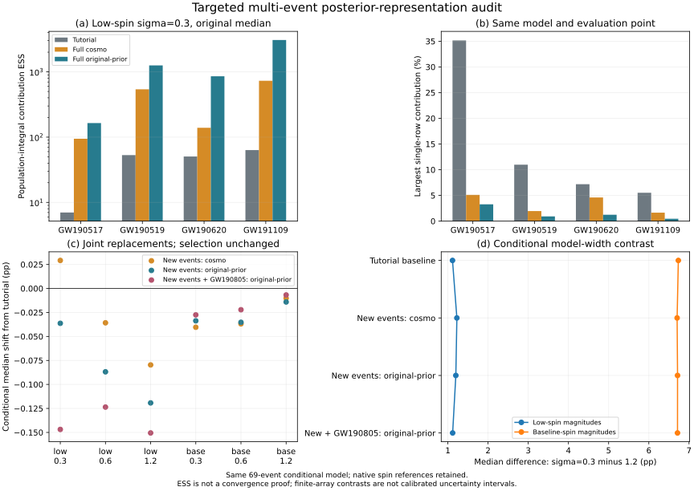

# 阶段七：关键事件的完整后验表示对照

2026-10-25。四个事先选定的新事件已完成，另加入阶段五的GW190805构成五事件联合对照。该阶段回答的是：在同一69事件、同一选择函数和六种固定模型设定下，恢复更多原始先验样本，是否消除已有的模型差异？

结论：这批定向选择的事件中，恢复完整原始先验样本明显减轻了单行贡献集中，但未消除模型间差异。五事件共同替换后，六种设定的条件中位数位移绝对值均小于0.151个百分点。这个结果不等于目录整体已收敛，也不是形成渠道比例的测量。

后续[完整O3选择积分对照](../population-selection-audit/README.md)发现，低自旋组模型差异从本阶段的1.11855缩小到0.26840个百分点。必须与本阶段一起阅读；不能将固定选择函数下的结果扩展为选择效应稳健性结论。

## 来源与样本

[事前设计](design.md)采用阶段六三项排名各前三的并集，固定新事件索引19、20、25、50。八份HDF共1,658,552,960字节，全部通过公开MD5及SHA256核验，见[下载清单](downloads.json)。[逐行来源报告](event-provenance.json)确认每事件的6913条教学样本都唯一来自`C01:IMRPhenomXPHM`；完整cosmo数组全部唯一包含于nocosmo数组。七个联合坐标、额外质量/距离与已保存log likelihood严格相等，相关配置与先验字符串一致。

| 事件 | cosmo行数 | 原始先验行数 | 原生参考频率 |
|---|---:|---:|---:|
| GW190517_055101 | 61,249 | 161,299 | 20 Hz |
| GW190519_153544 | 42,168 | 150,207 | 10 Hz |
| GW190620_030421 | 32,655 | 152,410 | 10 Hz |
| GW191109_010717 | 109,061 | 270,070 | 20 Hz |

两种表示使用匹配的PE先验密度，并经`WeightedEvent`计算积分。连续权重换先验时同时改变样本权重和先验分母；它只改变事件积分的超参数无关常数，群体后验保持不变。完整原始样本并非新增独立观测，cosmo与nocosmo也不是两个独立PE实验。

## 数值集中与模型差异

以下均在原低自旋幅度模型、倾角宽度σ=0.3的条件中位数处计算：

| 事件 | 教学→完整原始先验贡献ESS | 最大单行贡献变化 |
|---|---:|---:|
| GW190517 | 7.00 → 164.06 | 35.16% → 3.27% |
| GW190519 | 52.99 → 1,255.39 | 10.98% → 0.92% |
| GW190620 | 50.45 → 854.62 | 7.18% → 1.25% |
| GW191109 | 63.27 → 3,073.64 | 5.52% → 0.47% |

五事件共同替换后，六模型中位数位移依次为−0.14690、−0.12360、−0.15056、−0.02750、−0.02216、−0.00675个百分点。顺序为低自旋幅度Beta(1.5,8.5)的σ=0.3/0.6/1.2，再为基线幅度Beta(2,5)的相同三种宽度。比较量为共同支持上的`r=P(cos tilt_1<0)`，共同均匀先验支持为[0.34173978699379726,0.5]。

| σ=0.3减σ=1.2的r中位数差 | 教学基线 | 四新事件原始先验 | 五事件原始先验 |
|---|---:|---:|---:|
| 低自旋幅度组 | 1.11489 pp | 1.19785 pp | 1.11855 pp |
| 基线自旋幅度组 | 6.73380 pp | 6.71417 pp | 6.71305 pp |

单个事件的变化可相互抵消：GW190517在第一设定使中位数增加0.10250个百分点，而GW190805使其减少0.11139个百分点。因此不能只用很小的联合净变化证明每个事件稳定。



完整逐事件、逐模型结果见[comparison-results.json](comparison-results.json)。`partial-*`文件仅保留中途历史，不作为最终四事件结果。

## 核验与适用范围

[独立验证](validation.json)以完整69事件乘积重算，最大分位数差为1.44×10⁻¹⁵；连续换测度前后差为4.44×10⁻¹⁶；1001→2001点网格加密的最大分位数差为1.54×10⁻⁷。三个冻结输入的SHA256未改变。

[探索性边界诊断](support-audit.json)检查已保存样本距声明先验边界1%区间的贡献。两种幅度模型落在a1或a2>0.99之外的总体概率分别为6.83×10⁻¹⁷与1.19×10⁻⁹。这是总体模型概率，不是未观测似然尾部或证据误差的上界。

本阶段保留各事件原生自旋参考，没有进行共同频率演化；选择函数不变；GW191109的噪声/glitch处理不变；未恢复全目录所有PE支持或RIFT先验。因此结论限于这些固定条件。与Ashton、Hussain等及Udall等工作的重叠和差别见[文献对照](literature-context.md)，不把重要性采样或ESS诊断主张为新方法。

## 复现

先恢复阶段三至六依赖，再依次运行。下载需网络；提取需h5py；分析需NumPy、SciPy、Astropy，绘图需matplotlib。

```text
python research/population-stage7/download_events.py
python research/population-stage7/extract_events.py
python research/population-stage7/run_comparison.py
python research/population-stage7/audit_support.py
python research/population-stage7/validate_comparison.py
python research/population-stage7/plot_comparison.py
```

不运行根目录`model.py`，不覆盖冻结结果或论文。原始HDF、NPZ和PNG预览留在本机；来源清单、脚本、派生JSON与SVG可公开。总研究下一步转向分观测期的注入支持与完整O3样本对照。
